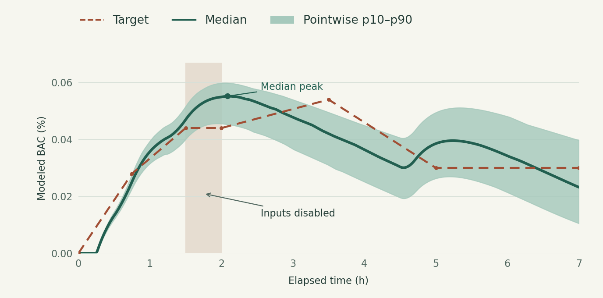
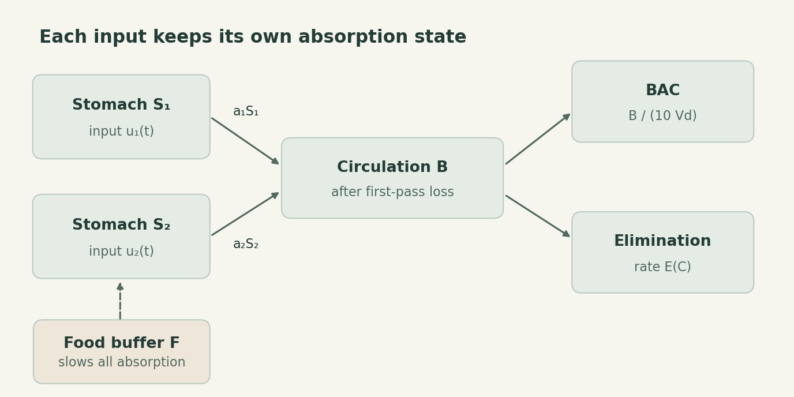
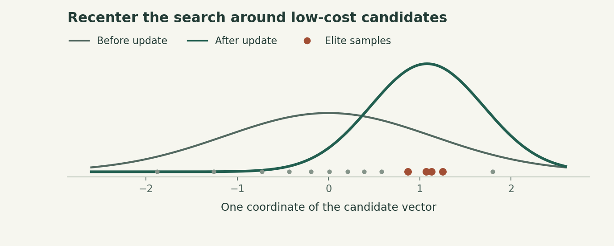

## What makes a reference hard to follow?

I started with a seven-hour reference curve drawn as a set of points. The reference is flat between 1.5 and 2 hours, when the model allows no new input. The simulated concentration rises through that interval and reaches its maximum at 2 hours and 5 minutes. The target reaches its maximum at 3 hours and 30 minutes. That gap captures the design problem. I choose the inputs. Their timing and the stored mass determine the trajectory.

<figure class="project-figure">
  
  <figcaption>Output from the Swift solver for a synthetic seven-hour case using the Standard preset. The shaded interval on the time axis disables new inputs. The green band spans the 10th to 90th percentile at each simulated minute.</figcaption>
</figure>

## Modeling the system forward

My case study uses blood alcohol concentration (BAC) as the output of a nonlinear pharmacokinetic model. Time is measured in hours and the state records mass in grams. For an event that delivers mass $G_i$ over $d_i$ hours, its input $u_i(t)$ is $G_i/d_i$ while that event is active and zero otherwise. I gave each event its own stomach compartment $S_i$ so that two events can have different rates of absorption even after both inputs have ended.

<figure class="project-figure">
  
  <figcaption>Two events shown schematically. The implementation adds one stomach state per scheduled event and shares the circulating mass and food buffer within each simulated subject.</figcaption>
</figure>

Absorption moves mass out of $S_i$ at a rate $a_iS_i$. The baseline absorption constant is $k_{a,i}$. I divide it by $1+\alpha F$ to slow absorption when the food buffer $F$ is large. The buffer itself decays at rate $k_F$. This gives two coupled equations.

$$
\frac{dS_i}{dt}=u_i(t)-a_i S_i,
\qquad a_i=\frac{k_{a,i}}{1+\alpha F}.
$$

$$
\frac{dF}{dt}=-k_F F.
$$

A fraction $f$ is removed on first pass, before the absorbed mass reaches circulation. Circulating mass $B$ divided by apparent distribution volume $V_d$ gives concentration $C$ in grams per liter. The published curves use $b=C/10$ in BAC percent. I model elimination with a saturating rate $E(C)$, where $V_{\max}$ is the maximum elimination rate and $K_m$ is the concentration at which it reaches half that rate.

$$
\frac{dB}{dt}=(1-f)\sum_i a_iS_i-E(C),
\qquad E(C)=\frac{V_{\max}C}{K_m+C}.
$$

Concentration rises whenever absorption into circulation exceeds elimination, even when every $u_i$ is zero. A flat segment needs those two rates to balance throughout the interval. That is why picking an input by looking only at the target at that minute can give the wrong intuition.

### A closed-form check before running the search

With no further absorption, I can separate the elimination equation and integrate from a starting BAC $b_0$ down to a positive endpoint $b_T$. The time estimate is

$$
\tau=\frac{V_d}{V_{\max}}
\left[10(b_0-b_T)+K_m\log(b_0/b_T)\right].
$$

The backend uses this expression with nominal parameters to estimate a decay window. It can also run the calculation backward by bisection to find a starting level compatible with a given window. Residual absorption can lengthen the decline in the full simulation, so this is an optimistic estimate for the nominal model. When the drawn curve stays above the requested endpoint, the interface offers an edited taper for review. The solver applies the terminal constraint when the visible curve ends within the configured tolerance.

## Turning a curve into an optimization problem

I interpolate the drawn anchors to form the reference $r(t)$. The solver uses a bounded copy of those anchors when they exceed the configured ceiling margin. Each phase is divided into slots of approximately 15 minutes. The vector for a slot encodes an activation value, one score per allowed input type, an amount and a duration variable. A threshold switches an event on, and the highest type score selects its input. Depending on the phase, the amount can vary or be fixed to one serving. Duration can be bucketed or set by the selected input and phase. The decoder skips overlapping events and enforces phase boundaries. This makes the inverse problem mixed discrete and continuous. A slight change in a vector can switch an event off entirely.

### Modeling uncertainty before scoring a candidate

I vary distribution volume, maximum elimination rate, first-pass loss and the two food parameters around nominal values. Independent draws can cluster and leave gaps, especially with small batches. For each parameter I divide the probability range into $M$ equal bins and draw once from each bin. A draw from bin $i$ is $u_i=(i+\xi_i)/M$, where $\xi_i$ is uniform on $[0,1)$. For a positive parameter with nominal value $\theta_0$, the engine uses the transformation $\theta_i=\theta_0\exp\big(\sigma\Phi^{-1}(u_i)\big)$, where $\Phi^{-1}$ converts a probability into a standard normal value and $\sigma$ sets the spread. I shuffle the bins independently for each parameter before pairing them into simulated subjects. This is Latin hypercube sampling.

For a candidate schedule $s$, I rank its simulated outputs separately at each minute $t_j$. The median $m_j$ drives tracking and the 90th percentile $q_j$ drives the upper-limit check. Reusing the same parameter draws across candidates lets the search compare schedules on equal terms. The band in the first figure summarizes variation under these assumed parameters. Its edges can come from different simulations at different times. Interpreting the band as a whole-trajectory probability would require a joint analysis across time.

### Defining what wins

I minimize the time integral of the squared gap between the median and the reference, evaluated by the trapezoidal rule. I add a cost for each scheduled event and a cost for total variation, which sums the absolute changes in the median. The factor of 100 makes a gap from 0.04 to 0.05 one unit of error before squaring. If $n_s$ is the number of events, the score for feasible candidates is

$$
J(s)=\int_0^T [100(m(t)-r(t))]^2\,dt
     +0.1n_s+0.05\sum_j 100|m_{j+1}-m_j|.
$$

The engine supports time weights in the tracking integral, with unit weights in this example. During the search, exceeding the ceiling or an enforced terminal limit adds a squared penalty of $10^5(100\Delta)^2$ for each excess $\Delta$. At final selection I apply the modeled limits as rejection rules. The maximum of $q_j$ must stay below or equal to the ceiling, and $q_j$ at the last sample must meet the terminal limit when it is active.

In the first figure, integrated tracking error contributes **3.268**, four events contribute **0.400**, and total variation contributes **0.531**, for a score of **4.199**. The all-zero schedule scores **102.841** against this same target. The early peak matters through its contribution to tracking error across time. Moving it closer to the target can still worsen the objective if that move increases the error elsewhere.

## Searching when the decoder is discontinuous

I use a bounded, diagonal cross-entropy search. Each coordinate of the candidate vector has a mean and a spread. I sample a population, decode and simulate each candidate, then rank them by score. The best group updates the sampling means and spreads, with more weight on higher-ranked candidates. Diagonal means each coordinate is sampled independently before decoding. For coordinate $k$, let $\mu_k$ be its current mean and $\sigma_k$ its spread. I draw a standard normal value $z_k$, scale it and clip the result to the allowed range.

$$
x_k=\operatorname{clip}(\mu_k+\sigma_k z_k,\,l_k,\,u_k).
$$

The next mean and spread move toward the rank-weighted mean and standard deviation of the top candidates. Smoothing carries part of the previous distribution forward, and a lower bound on the spread keeps the search exploring.

<figure class="project-figure">
  
  <figcaption>Illustration of one coordinate in a search update. The dots represent trial values and the highlighted trials contribute to the next sampling distribution. The curves illustrate the algorithm using schematic data.</figcaption>
</figure>

I seed the population with several timings around the reference. I also keep an archive and refine several promising schedules. Local refinement can move an event to an earlier slot and turn the original slot off in the same trial. Trying those edits separately can make each trial score worse, even when applying them together improves the fit.

The Standard preset runs 28 generations of 24 candidates, followed by local refinement. It uses 30 simulated subjects during the search and a separate set of 72 for final selection. The larger ensemble can change the ranking or expose a ceiling violation. I compare the feasible finalists with an empty schedule and use the final ensemble again for the plotted result. This gives me a reproducible way to compare the schedules I found. The search is finite, so the best candidate found depends on the encoding and the search budget.

## What I tested in the backend

I use fourth-order Runge–Kutta with a one-minute reporting grid. An early integrator could undercount a short input because the input rate could jump between its evaluation points. I isolated the bug by disabling absorption and feeding 14 grams into a single stomach compartment over 30 seconds. In one alignment the old integrator reported about 4.67 grams. The revised integrator splits each step at input changes and holds the input rate constant within each resulting substep. The regression test recovers 14 grams with the 30-second event starting at 0, 7.5 and 25 seconds within a minute.

The SwiftUI app calls the Swift engine directly. The local browser app and Python interface pass the same serialized problem to a CLI built from that engine. I compared macOS and Linux runs for three saved cases, one per preset, and checked event times and amounts along with every sampled quantile. All three matched, including the 421 output points of the seven-hour case. That check isolates platform reproducibility for those inputs. The physiology and uncertainty assumptions would require separate validation against measurements.

The part I would carry into robotics is the separation between the reference, the forward model, the candidate search and the final checks. A planner for a robot with actuator delay and uncertain payload would need a different dynamics model. It would face the same question about whether a candidate that tracks well under one set of assumptions still satisfies its constraints when those assumptions change.
