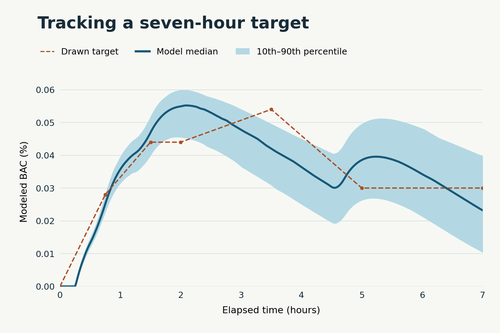

<figure class="project-figure">
  
  <figcaption>A seven-hour run using the default synthetic profile and the Standard search preset. The target stays flat through the last two hours, while the simulated median rises and then falls. The blue band spans the 10th to 90th percentile at each minute across the sampled model parameters.</figcaption>
</figure>

## Drawing the problem

In the editor, you drag points to set the target at particular times. You also divide the timeline into phases. In the example below, the target stays level between hours 1.5 and 2, and the middle phase allows no new input. The model still has ethanol moving from the stomach into circulation during that interval. Holding the orange line level on screen is easy. Finding a schedule whose simulated response does the same is harder.

<figure class="project-figure">
  
  <figcaption>The target editor in the local browser app. The circles are editable anchors. Shaded regions show where the rules for the search change.</figcaption>
</figure>

## How the search chooses a schedule

The forward model takes a schedule as input. It tracks ethanol in the stomach and in circulation, accounting for absorption, food and elimination. NightCurve runs each candidate through several versions of that model, sampling parameters such as absorption rate and distribution volume. That produces a family of possible curves for the same input.

The search scores a schedule by accumulating the squared gap between its median curve and the target over time. Two smaller terms penalize the number of events and the total variation in the median. An extra event therefore has to improve the fit enough to earn its place. Each event must fit inside an allowed phase and finish before the next event begins.

A cross-entropy search samples candidate schedules, keeps the best-scoring group and uses that group to update where it samples next. After local refinement, the engine compares the finalists and an empty schedule on a larger set of model variations. At each minute it checks the 90th percentile against the configured ceiling. An optional end constraint applies the same check at the final time. The chart shows the ensemble used for that final decision. Its band describes variation within this model. Actual BAC and impairment require independent assessment.

## The 30-second test

A short event exposed a numerical error. The simulator reports one point per minute, but an input can start and finish between two of those points. To isolate the error, I turned off absorption in a test and gave the stomach compartment a 30-second input containing 14 grams. With nowhere else for the mass to go, the compartment had to end with 14 grams. One alignment of the old integrator produced only about 4.67 grams.

The solver now splits its integration step wherever an input starts or stops, while still reporting the curve once per minute. The regression test moves the same input to three offsets within the minute, starting at 0, 7.5 and 25 seconds. All three recover the full 14 grams. That matters to the optimizer because an error tied to the clock can make one candidate look better simply by shifting its start time.

## One calculation on phone and desktop

The offline SwiftUI app, the local browser app and the command-line tool share a Swift engine. A saved input captures the target anchors, phase rules, model profile, constraints and search preset. The Python interface can send that same input to the engine and read back the schedule and its trajectories.

I compared macOS and Linux results for three saved inputs, one each at Quick, Standard and High quality. For each input, the event times and amounts matched, as did every reported value in the median and both percentile curves. The seven-hour Standard case had 421 samples, including both endpoints. That check tests whether the software reproduces a calculation across machines. How well the model represents an individual is a separate question.
