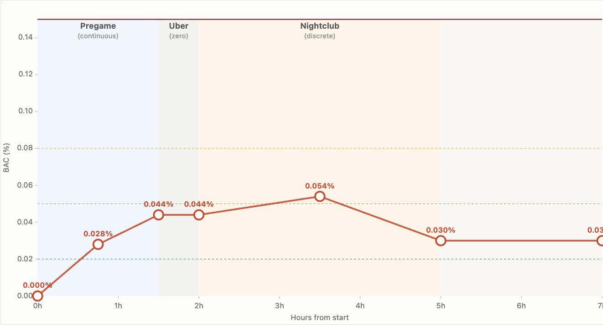

## Why did this curve win?

The peak arrives early, yet this schedule wins among the feasible candidates the solver evaluated. To see why, start with the actual score from the seven-hour simulation. The solver minimizes the sum of three terms.

$$
\underbrace{3.268}_{\text{tracking error}}+
\underbrace{0.400}_{\text{four events}}+
\underbrace{0.531}_{\text{curve movement}}
\approx 4.199
$$

Peak timing has no separate penalty. Moving a peak closer to its target helps only if the improvement outweighs the error introduced elsewhere on the curve. The blue line below shows where the winning schedule gained and lost ground against the orange target.

<figure class="project-figure">
  
  <figcaption>A seven-hour run using the default synthetic profile and the Standard search preset. The target stays flat through the last two hours, while the simulated median rises and then falls. The blue band spans the 10th to 90th percentile at each minute across the sampled model parameters.</figcaption>
</figure>

## Drawing the problem

In the editor, you drag points to set the target at particular times. You also divide the timeline into phases. In the example below, the target stays level between hours 1.5 and 2, and the middle phase allows no new input. The model still has ethanol moving from the stomach into circulation during that interval. Holding the orange line level on screen is easy. Finding a schedule whose simulated response does the same is harder.

<figure class="project-figure">
  
  <figcaption>The target editor in the local browser app. The circles are editable anchors. Shaded regions show where the rules for the search change.</figcaption>
</figure>

## From a schedule to a trajectory

NightCurve solves the problem in both directions. The forward calculation takes a schedule and predicts a curve. The inverse calculation starts with the desired curve and calls the forward calculation many times, changing the schedule between calls. The delay visible in the figure comes from the forward model's internal state.

For event $i$, let $S_i$ be the grams still in the stomach, $u_i$ the input rate in grams per hour and $a_i$ the absorption rate per hour. In the model, $a_i$ depends on the event and the food buffer. The rate of transfer out of that compartment is $a_i S_i$. Let $B$ be the mass in circulation and $f$ the fraction lost on first pass. The two mass balances are

$$
\frac{dS_i}{dt}=u_i-a_i S_i
$$

$$
\frac{dB}{dt}=(1-f)\sum_i a_i S_i-E(C).
$$

Concentration $C$ is circulating mass divided by distribution volume. The elimination rate is $E(C)=V_{\max} C/(K_m+C)$, where $V_{\max}$ is the limiting rate and $K_m$ is the concentration at half that rate. This gives the inverse problem a memory. Setting every input rate to zero during the middle phase leaves the absorption terms active, so the simulated curve can keep rising. The Swift backend integrates these equations with fourth-order Runge–Kutta steps.

## What counts as a better fit?

Each candidate is simulated with a shared set of parameter draws. The engine stratifies each uncertain parameter's distribution before sampling, so a finite ensemble covers both central and tail values. At each output minute it sorts the simulated concentrations to obtain the median and upper percentile. Using the same draws for competing schedules makes their scores comparable.

Write $m_j$ for the median BAC at minute $j$ and $r_j$ for the target interpolated between the drawn anchors. Both use the chart's percent units, so a gap from 0.04 to 0.05 gives a scaled error $e_j=100(m_j-r_j)$ of magnitude one. With target weights $w_j$ and time measured in hours, the engine integrates the weighted squared error by the trapezoidal rule. For feasible schedules its objective is

$$
J=\int w(t)e(t)^2\,dt+0.1N+0.05\sum_j 100\lvert m_{j+1}-m_j\rvert .
$$

Here $N$ counts events. The last term measures the total movement of the median, including every rise and fall. Suppose a candidate adds one event and leaves that total movement unchanged. Its integrated tracking error must fall by more than 0.1 to improve its score. In the seven-hour run above, the tracking term was 3.268, four events contributed 0.400, and curve movement added about 0.531. The final score was 4.199.

## How the backend searches and decides

A candidate combines discrete choices, such as which item to use in a phase, with continuous choices about timing and amount. The engine decodes a bounded vector into events that fit the phase rules without overlapping. A small change to the vector can switch an event on or change its type. NightCurve uses a derivative-free cross-entropy search so it can compare these alternatives by simulating them.

The first generation includes several starting schedules. In each round the engine ranks a population by score, then moves the sampling mean and spread of each coordinate toward the best group, giving higher-ranked candidates more weight. It retains promising alternatives and refines several of them by changing one coordinate at a time. Quick, Standard and High set the computational budget. The result is the best feasible candidate found in that search, with no guarantee of a global optimum.

Tracking the median is only one part of selection. During search, squared penalties discourage candidates whose pointwise 90th percentile exceeds the configured ceiling or an enforced final target. For the final decision the engine evaluates the shortlist again with a larger ensemble, checks feasibility and compares it with the empty schedule. A candidate that tracked the target closely in the smaller ensemble can lose here. The returned chart uses the same larger ensemble that determined the winner. Its shaded band describes modeled variation at each time, and does not estimate an individual's actual impairment.

## The 30-second test

A short event exposed a numerical error. The simulator reports one point per minute, but an input can start and finish between two of those points. To isolate the error, I turned off absorption in a test and gave the stomach compartment a 30-second input containing 14 grams. With nowhere else for the mass to go, the compartment had to end with 14 grams. One alignment of the old integrator produced only about 4.67 grams.

The solver now splits its integration step wherever an input starts or stops, while still reporting the curve once per minute. The regression test moves the same input to three offsets within the minute, starting at 0, 7.5 and 25 seconds. All three recover the full 14 grams. That matters to the optimizer because an error tied to the clock can make one candidate look better simply by shifting its start time.

## One calculation on phone and desktop

The offline SwiftUI app, the local browser app and the command-line tool share a Swift engine. A saved input captures the target anchors, phase rules, model profile, constraints and search preset. The Python interface can send that same input to the engine and read back the schedule and its trajectories.

I compared macOS and Linux results for three saved inputs, one each at Quick, Standard and High quality. For each input, the event times and amounts matched, as did every reported value in the median and both percentile curves. The seven-hour Standard case had 421 samples, including both endpoints. That check tests whether the software reproduces a calculation across machines. How well the model represents an individual is a separate question.
