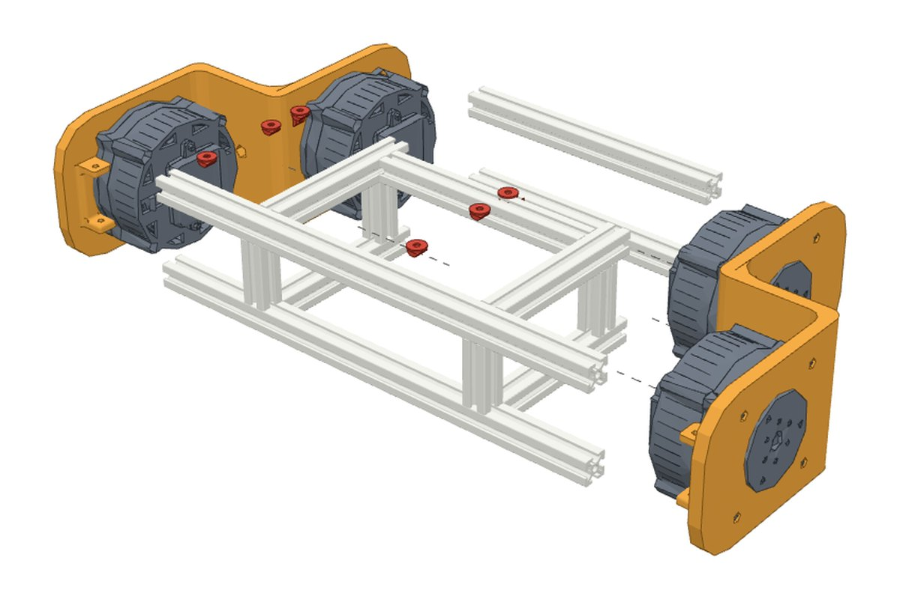
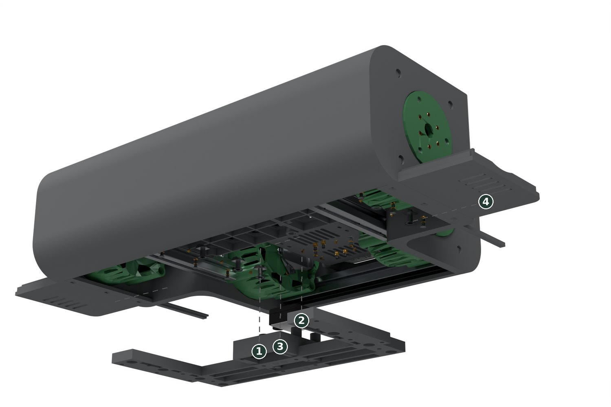
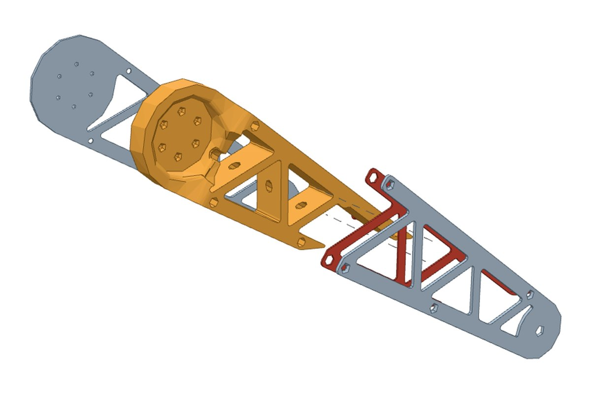
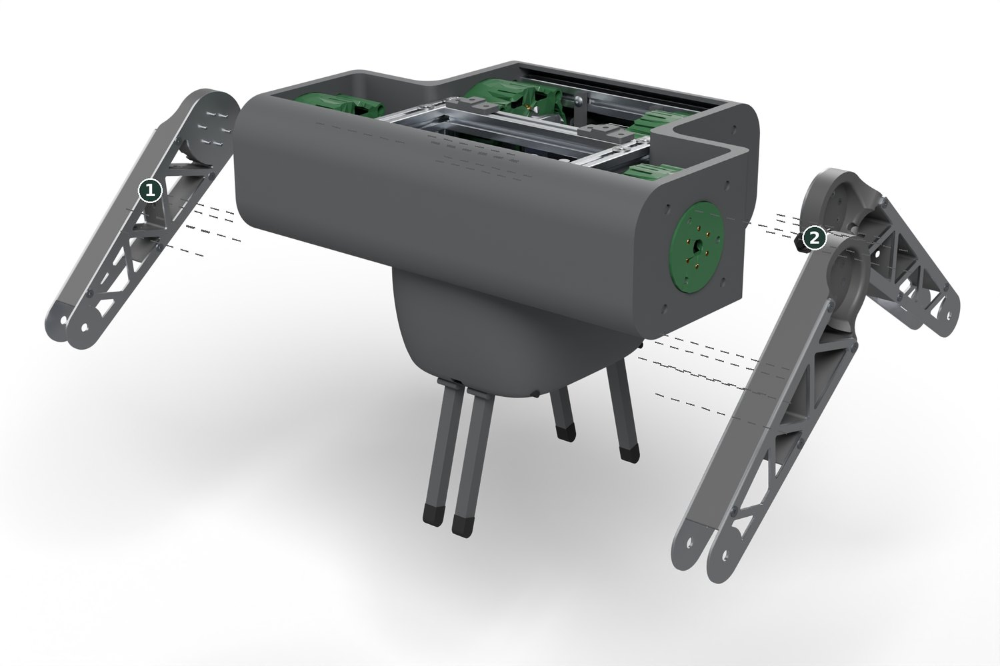
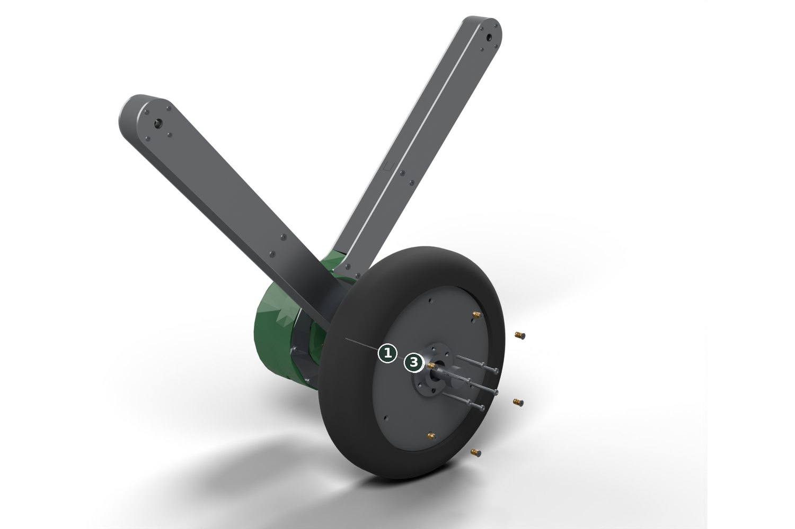
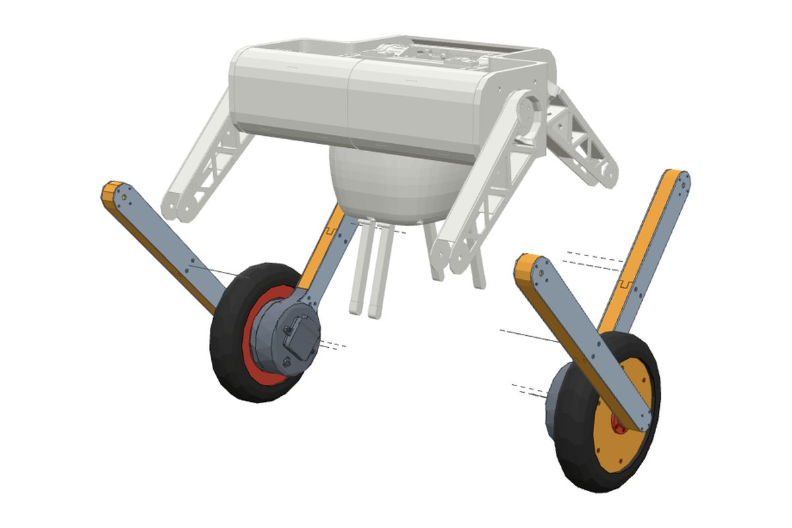
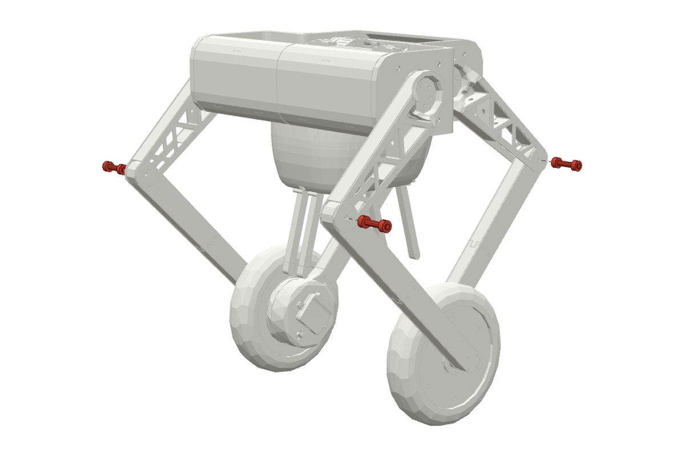
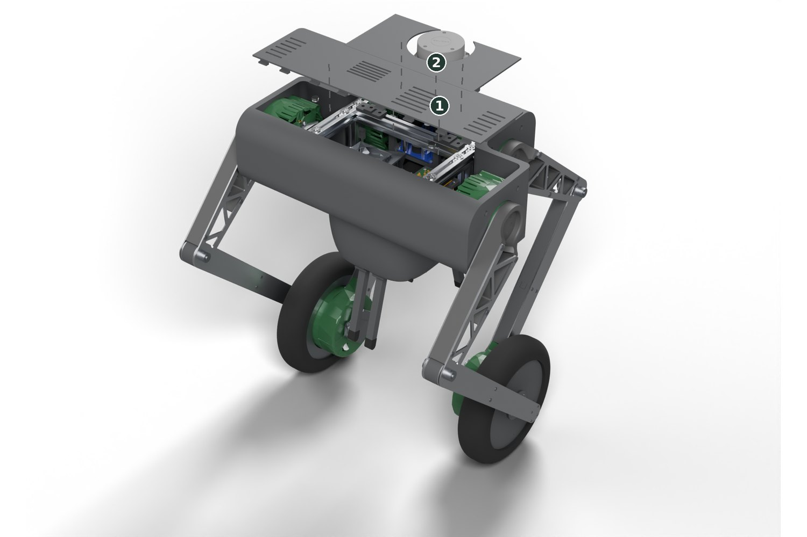
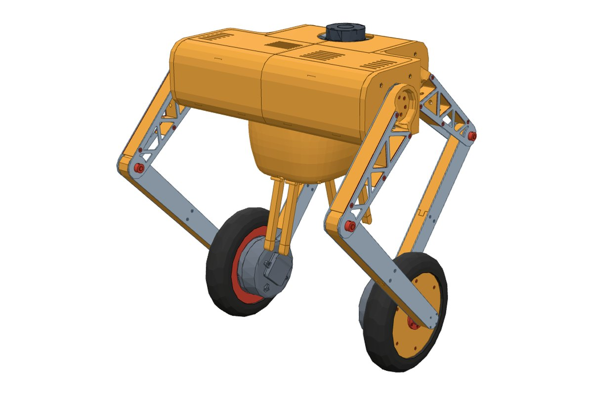

This guide follows the main Fusion 360 assembly of [PRIMUS](/portfolio/primus/). Each step lists the parts it adds and the hardware that holds them. The hardware is counted directly from the CAD: a screw belongs to the last step among the parts it touches. The pictures are rendered in Blender from the CAD with its materials; the parts added in a step are pulled out along their assembly direction, with dashed lines to where they go and numbers that match the list under each picture. Every step can also be played as a 3D animation.

The order below is one the parts allow, not a timed procedure. Torques, cable routing and wiring are not in the CAD and are not covered yet. Where the CAD leaves something open, such as how the aluminium profiles join each other, the step says so. Part names in parentheses are the component names in the Fusion file and in the exported STL files.

## Before you start

**Print the parts.** All printed parts are listed in the [bill of materials](#bill-of-materials). The CAD assigns PET (PETG) to most of them, ABS to the arm cores, and a carbon-filled PA12 to the landing-gear struts and stops. The tyres are modelled as rubber.

**Install the heat-set inserts.** Brass inserts go into the printed parts before assembly: 41 × M3 × 5.7 mm (OD 4.6), 12 × M3 × 5.7 mm (OD 5), 16 × M3 × 6 mm (OD 5), 4 × M3 × 4 mm and 8 × M2.5 × 4 mm. Each step lists the inserts its parts carry, so you can also set them step by step. Press them in square to the surface with the iron at the temperature the insert maker recommends, and let the part cool before loading the thread.

**Build the six actuators.** PRIMUS uses actuators derived from Aaed Musa's [OpenQDD V1](https://github.com/aaedmusa/OpenQDD-V1), a 3D-printed quasi-direct-drive actuator with a 9:1 helical planetary gearbox. PRIMUS keeps the 9:1 ratio but uses a stronger, modified printed gearbox, a 130 kV motor and mjbots moteus-r4 controllers at 24 V. Four are hip actuators and two drive the wheels; the wheel version has a larger output housing. Build them following the [OpenQDD instructions](https://www.instructables.com/OpenQDD-V1-3D-Printed-Robotic-Actuator) with the PRIMUS parts. On the hip actuators, the four M4 screws that close the housing are 45 mm long so they continue through the hip box in step 2.

**Tools.** Hex keys of 1.3, 2, 2.5, 3 and 4 mm (countersunk M2 to M5 and the socket-head screws), and a soldering iron with an insert tip.

**How to read the steps.** Every step has a rendered exploded view with numbered parts, the list of what those numbers are, the actions in order, and the hardware it uses. Press **Play animation** on any step to watch the parts go together in 3D; you can drag to look around while it plays.

<ol class="assembly-steps">
<li class="assembly-step" id="step-1" data-step="frame">
<h2>Frame</h2>

<ol class="asm-legend"><li>20×20 aluminium frame</li></ol>
<ol class="asm-actions">
<li>Cut or buy the thirteen 20×20 profiles: 2 × 400 mm, 2 × 228 mm, 1 × 188 mm, 4 × 140 mm and 4 × 53 mm.</li>
<li>Join them into the cage shown. The CAD does not model the joints between profiles, so use the method you prefer for 2020 extrusion and check that the cage sits flat and square.</li>
<li>Slide the two T-nuts for this step into the slots before closing the profile ends that would block them.</li>
</ol>

<strong>Hardware.</strong> 2 × M5 drop-in T-nuts (2020, slot 6).

</li>

<li class="assembly-step" id="step-2" data-step="hip-modules">
<h2>Hip boxes and hip actuators</h2>

<ol class="asm-legend"><li>Hip actuator (4)</li><li>Hip box (Caixa do quadril X+ and X−)</li></ol>
<ol class="asm-actions">
<li>Place two hip actuators in each hip box, outputs facing out through the box wall. The front and rear actuators sit 140 mm apart.</li>
<li>Fix each actuator with its four M4 × 45 screws from the actuator build and their M4 nuts.</li>
<li>Drop the T-nuts for this step into the profile slots where the boxes meet the frame. Several of them only receive their screws later, with the belly in step 7.</li>
<li>Bring each box onto its end of the frame and fix it with the M5 × 10 socket-head screws and washers.</li>
</ol>

<strong>Hardware.</strong> 10 × M5 drop-in T-nuts, 4 × M5 × 10 socket head (ISO 4762), 6 × washers 5.3 × 15 × 1.2.

</li>

<li class="assembly-step" id="step-3" data-step="rear-and-top">
<h2>Rear covers and upper supports</h2>

<ol class="asm-legend"><li>Magnet holder (6)</li><li>Rear cover half (Tampa Y− metade X+ and X−)</li><li>Upper supports (Suportes superiores)</li><li>Small Orin support</li></ol>
<ol class="asm-actions">
<li>Fit the six magnet holders on the rear face of the frame.</li>
<li>Close the back of the body with the two rear cover halves.</li>
<li>Fix the upper supports across the top of the frame; they later hold the magnetic top covers. Add the small Orin support.</li>
</ol>

<strong>Hardware.</strong> 4 × M5 drop-in T-nuts, 4 × M5 × 10 socket head, 2 × washers 5.3 × 15 × 1.2.

</li>

<li class="assembly-step" id="step-4" data-step="electronics">
<h2>Electronics tray</h2>

<ol class="asm-legend"><li>Electronics tray (Base eletronica v2)</li><li>Jetson Orin Nano in its case</li><li>Raspberry Pi 5</li><li>Power board bridge</li><li>Power distribution board</li></ol>
<ol class="asm-actions">
<li>Join the two halves of the electronics tray with 2 × M3 × 12 button-head screws into the two M3 inserts.</li>
<li>Lower the tray onto the frame and fix it with 7 × M5 × 10 countersunk screws into T-nuts.</li>
<li>Screw the four M2.5 × 20 brass standoffs into the inserts of the tray and the bridge, mount the Raspberry Pi 5 on them, and fix the power distribution board on its bridge.</li>
<li>Fix the Orin case to the tray with 4 × M3 × 8 button-head screws.</li>
</ol>

<strong>Hardware.</strong> 7 × M5 × 10 countersunk (DIN 7991), 7 × M5 T-nuts; 4 × M2.5 × 20 male–female brass standoffs, 8 × M2.5 × 4 inserts, 4 × M2.5 × 6 and 4 × M2.5 × 5 button head; 4 × M3 × 8 button head; 2 × M3 × 12 button head, 2 × M3 × 5.7 inserts.

</li>

<li class="assembly-step" id="step-5" data-step="front">
<h2>Converters and front cover with the camera</h2>

<ol class="asm-legend"><li>Converter shelf</li><li>XL4016 converters (2)</li><li>Camera bracket</li><li>RealSense D435i</li><li>Front cover (Tampa frontal Y+)</li></ol>
<ol class="asm-actions">
<li>Screw the two XL4016 converters to their shelf with M3 × 6 button-head screws into the shelf inserts.</li>
<li>Fix the shelf to the front of the frame with 4 × M5 × 10 button-head screws into T-nuts.</li>
<li>Mount the RealSense on its bracket with 2 × M3 × 6, and the bracket on the front cover with 4 × M3 × 8 into the cover's inserts.</li>
<li>Close the front of the body with the cover, fixing it with M5 × 10 socket-head screws into T-nuts.</li>
</ol>

<strong>Hardware.</strong> 12 × M5 drop-in T-nuts, 8 × M5 × 10 socket head, 4 × M5 × 10 button head (ISO 7380); 10 × M3 × 6 button head, 4 × M3 × 8 button head, 12 × M3 × 5.7 inserts.

</li>

<li class="assembly-step" id="step-6" data-step="lower-frame">
<h2>Lower frame, IMU and battery shoe</h2>

<ol class="asm-legend"><li>Lower frame (Quadro inferior, two halves)</li><li>IMU (WitMotion WT901C)</li><li>Battery shoe (Receptor M18)</li><li>Lower side cover (X+ and X−)</li></ol>
<ol class="asm-actions">
<li>Turn the body over. Join the two mitred halves of the lower frame and fix it under the body.</li>
<li>Screw the IMU to the lower frame with 2 × M3 × 8 button-head screws into inserts. Its orientation sets the robot's attitude estimate, so mount it square to the frame.</li>
<li>Fit the battery shoe; its screws go in with the battery in step 8.</li>
<li>Close the sides under the hip boxes with the two lower side covers, using M3 × 8 countersunk screws.</li>
</ol>

<strong>Hardware.</strong> 8 × M5 drop-in T-nuts; 6 × M3 × 8 countersunk, 2 × M3 × 8 button head, 8 × M3 × 5.7 inserts, 4 × M3 × 4 inserts.

</li>

<li class="assembly-step" id="step-7" data-step="belly">
<h2>Belly and retractable landing gear</h2>

<ol class="asm-legend"><li>Landing-gear strut (front and rear)</li><li>MG90S servo (2)</li><li>Servo horn</li><li>Rear gear crank</li><li>Tie-rod (M2, 76.5 mm)</li><li>Gear stops</li><li>TPU plugs</li><li>Belly</li></ol>
<ol class="asm-actions">
<li>Screw the two MG90S servos into the belly with 2 × 8 self-tapping screws.</li>
<li>Insert the strut axles through the belly and close the insertion holes with the two TPU plugs.</li>
<li>Connect the front strut to its servo through the horn and the 76.5 mm tie-rod, and the rear strut through the printed crank.</li>
<li>Fix the four gear stops with M3 × 10 button-head screws into inserts; they set the end of the strut travel.</li>
<li>Lift the finished belly under the body and fix it with 8 × M5 × 12 button-head screws into the T-nuts placed in step 2, plus the M3 countersunk screws into the lower frame.</li>
</ol>

<strong>Hardware.</strong> 8 × M5 × 12 button head; 4 × self-tapping 2 × 8 pan head; 4 × M3 × 10 button head, 6 × M3 × 10 countersunk, 4 × M3 × 8 countersunk, 14 × M3 × 5.7 inserts.

</li>

<li class="assembly-step" id="step-8" data-step="battery">
<h2>Battery and battery door</h2>

<ol class="asm-legend"><li>Milwaukee M18 battery</li><li>Battery door</li></ol>
<ol class="asm-actions">
<li>Screw the battery shoe to the lower frame with 4 × M3 × 20 button-head screws.</li>
<li>Slide the M18 battery into the shoe from the front.</li>
<li>Press the four Ø6 × 3 magnets into the door and the belly and close the door over the battery.</li>
</ol>

<strong>Hardware.</strong> 4 × N52 magnets Ø6 × 3; 4 × M3 × 20 button head, 4 × M3 × 10 button head, 1 × M3 × 30 socket head, 5 × M3 × 5.7 inserts.

</li>

<li class="assembly-step" id="step-9" data-step="arm-build">
<h2>Hip arms</h2>

<ol class="asm-legend"><li>Inner arm plate</li><li>Thin steel plate (Body1 in the CAD)</li><li>Arm core (ABS)</li><li>Outer arm plate</li></ol>
<ol class="asm-actions">
<li>Lay the inner aluminium plate down and place the printed core on it.</li>
<li>Screw four M4 × 27 brass standoffs through the inner plate with M4 × 8 countersunk screws.</li>
<li>Close the arm with the outer plate and the remaining M4 × 8 screws.</li>
<li>Build four arms: two as drawn and two mirrored (upper arm espelhado).</li>
</ol>

<strong>Hardware, for all four arms.</strong> 16 × M4 × 27 female–female brass standoffs, 32 × M4 × 8 countersunk.

</li>

<li class="assembly-step" id="step-10" data-step="arms">
<h2>Arms on the hip actuators</h2>

<ol class="asm-legend"><li>Hip arm (4)</li><li>Cable gland (2)</li></ol>
<ol class="asm-actions">
<li>Fit each arm onto the output of its hip actuator, with the mirrored arms on the opposite corners as in the drawing.</li>
<li>Fix each arm with six M3 × 12 countersunk screws into the actuator output.</li>
<li>Fit the two M12 × 1.5 cable glands in the hip boxes, next to the front arms.</li>
</ol>

<strong>Hardware.</strong> 24 × M3 × 12 countersunk; 2 × M12 × 1.5 cable glands with locknut.

</li>

<li class="assembly-step" id="step-11" data-step="rear-link">
<h2>Rear lower links</h2>

<ol class="asm-legend"><li>Inner link plate</li><li>Link core with knee bearings</li><li>Outer link plate</li></ol>
<ol class="asm-actions">
<li>Press two 608-2RS bearings into the knee end of the printed core.</li>
<li>Screw the M2 × 22 and M3 × 22 brass standoffs to the inner plate with M2 × 6 and M3 × 6 countersunk screws.</li>
<li>Place the core and close the link with the outer plate. Build two links.</li>
</ol>

<strong>Hardware, for both links.</strong> 4 × 608-2RS bearings (8 × 22 × 7); 16 × M2 × 22 and 4 × M3 × 22 female–female brass standoffs; 32 × M2 × 6 and 8 × M3 × 6 countersunk.

</li>

<li class="assembly-step" id="step-12" data-step="shin">
<h2>Shins and wheel actuators</h2>

<ol class="asm-legend"><li>Inner shin plate</li><li>Shin core with knee bearings</li><li>Outer shin plate</li><li>Wheel actuator</li></ol>
<ol class="asm-actions">
<li>Build the shin like the rear link: two 608-2RS bearings in the core, standoffs on the inner plate, core, then the outer plate.</li>
<li>Set the sixteen M3 × 6 inserts (OD 5) for the wheel actuator, eight per shin.</li>
<li>Fix the wheel actuator to the lower end of the shin with 8 × M3 × 30 socket-head screws. This puts most of the leg's mass at the wheel. Build two shins.</li>
</ol>

<strong>Hardware, for both shins.</strong> 4 × 608-2RS bearings; 8 × M2 × 22 and 8 × M3 × 22 female–female standoffs; 16 × M2 × 6 and 16 × M3 × 6 countersunk; 16 × M3 × 30 socket head, 16 × M3 × 6 inserts (OD 5).

</li>

<li class="assembly-step" id="step-13" data-step="wheel">
<h2>Wheels and the closing joint</h2>

<ol class="asm-legend"><li>12 × 28 × 8 bearing</li><li>Tyre</li><li>Wheel hub parts</li></ol>
<ol class="asm-actions">
<li>Fit the two 12 × 28 × 8 mm bearings at the wheel axle, where the rear lower link meets the shin and closes the five-bar loop.</li>
<li>Fit the tyre on the hub and bring the wheel onto the wheel actuator.</li>
<li>Fix the wheel and the joint with six M3 × 30 low-head screws and six M3 × 8 countersunk screws into inserts, then check that the wheel turns freely. Repeat for the other leg.</li>
</ol>

<strong>Hardware, for both wheels.</strong> 4 × 12 × 28 × 8 mm bearings; 12 × M3 × 30 low-head socket (DIN 7984); 12 × M3 × 8 countersunk, 12 × M3 × 5.7 inserts (OD 5).

</li>

<li class="assembly-step" id="step-14" data-step="legs">
<h2>Lower legs on the robot</h2>

<ol class="asm-legend"><li>Lower leg (2)</li></ol>
<ol class="asm-actions">
<li>Bring each lower leg to its side of the robot.</li>
<li>Line the knee bearings of the shin up with the end of the front arm, and those of the rear link with the end of the rear arm.</li>
</ol>
</li>

<li class="assembly-step" id="step-15" data-step="knees">
<h2>Knee shafts</h2>

<ol class="asm-legend"><li>Knee shaft Ø8 × 50 with two collars (4)</li></ol>
<ol class="asm-actions">
<li>Slide a Ø8 × 50 mm shaft through each knee: through the arm end and the two 608 bearings of the link or shin.</li>
<li>Lock each shaft with a collar on each side, tightening the M4 set screws.</li>
<li>Move each leg by hand through its full range. The knees are passive, so they must fold and extend freely without binding.</li>
</ol>

<strong>Hardware.</strong> 4 × Ø8 × 50 mm shafts, 8 × Ø8 shaft collars with M4 set screws.

</li>

<li class="assembly-step" id="step-16" data-step="top">
<h2>Top covers and lidar</h2>

<ol class="asm-legend"><li>Top cover (4)</li><li>RPLIDAR A1</li></ol>
<ol class="asm-actions">
<li>Press the eight Ø10 × 3 magnets into the top covers and their seats.</li>
<li>Screw the RPLIDAR A1 to the two front covers.</li>
<li>Place the four covers; the magnets hold them, so the electronics stay reachable.</li>
</ol>

<strong>Hardware.</strong> 8 × N52 magnets Ø10 × 3; 8 × M5 × 6 button head.

</li>
</ol>

<figure class="project-figure">
  
  <figcaption>The finished robot, rendered in Blender from the Fusion 360 assembly.</figcaption>
</figure>

After step 16 the robot is complete. It starts parked on its landing gear, and the [operating notes](/portfolio/primus/#operating-primus) describe how it stands up.

## Bill of materials

Quantities are for one robot and come from the Fusion 360 assembly. The parts inside the actuators are covered by the OpenQDD bill of materials.

### Printed parts

| Part (CAD name) | Qty | Material in the CAD |
|---|---:|---|
| Hip box (Caixa do quadril X+, X−) | 1 + 1 | PETG |
| Rear cover halves (Tampa Y− metade X+, X−) | 1 + 1 | PETG |
| Upper supports (Suportes superiores) | 1 | PETG |
| Small Orin support (Suporte pequeno Orin) | 1 | PETG |
| Magnet holder | 6 | PETG |
| Electronics tray, two parts (Base eletronica v2) | 1 | PETG |
| Power board bridge (Ponte da placa de energia) | 1 | PETG |
| Converter shelf (Prateleira dos conversores XL4016) | 1 | PETG |
| Front cover (Tampa frontal Y+) | 1 | PETG |
| Camera bracket (Suporte da RealSense) | 1 | PETG |
| Lower frame, two halves (Quadro inferior) | 1 | PETG |
| Battery shoe (Receptor M18 – sapata) | 1 | PETG |
| Lower side covers (Tampa inferior lateral X+, X−) | 1 + 1 | PETG |
| Top covers (Tampa superior dianteira / traseira, X+ and X−) | 4 | PETG |
| Belly (Barriga organica) | 1 | PETG |
| Battery door (Tampa frontal da barriga) | 1 | PETG |
| Front and rear landing-gear struts (Trem dianteiro, Trem traseiro) | 1 + 1 | PA12-CF and PETG |
| Landing-gear stops (Batentes do trem) | 4 | PA12-CF |
| Rear gear crank (Manivela traseira) | 1 | PETG |
| Axle-hole plugs (Tampões) | 2 | TPU |
| Arm core (Component495) | 4 | ABS |
| Rear link core (Component3) | 2 | PETG |
| Shin core (Component9) | 2 | PETG |
| Wheel side disc (Body6 in the lower-leg component) | 2 | PETG |
| Printed parts of the six actuators | | see OpenQDD |

### Aluminium

| Part | Qty |
|---|---:|
| 20×20 profile, 400 mm | 2 |
| 20×20 profile, 228 mm | 2 |
| 20×20 profile, 188 mm | 1 |
| 20×20 profile, 140 mm | 4 |
| 20×20 profile, 53 mm | 4 |
| Arm outer plate, 2 mm (Outer sheet metal) | 4 |
| Arm inner plate, 2 mm (Inner sheet metal) | 4 |
| Rear link plates (Component2, Component4) | 2 + 2 |
| Shin plates (Component8, Component10) | 2 + 2 |

### Electronics and purchased parts

| Part | Qty |
|---|---:|
| Hip actuator, OpenQDD-derived, 9:1 | 4 |
| Wheel actuator, OpenQDD-derived, 9:1 | 2 |
| mjbots moteus-r4 controller (one per actuator) | 6 |
| NVIDIA Jetson Orin Nano developer kit, with case | 1 |
| Raspberry Pi 5 | 1 |
| Power distribution board, 50 × 80 mm, XT90 input and six XT30 outputs | 1 |
| XL4016 buck converter, 300 W | 2 |
| Intel RealSense D435i | 1 |
| Slamtec RPLIDAR A1 | 1 |
| WitMotion WT901C-TTL IMU | 1 |
| MG90S servo | 2 |
| Milwaukee M18 battery, 5 Ah | 1 |
| Tyre, Ø 215 mm (rubber in the CAD) | 2 |
| Cable gland M12 × 1.5 with locknut | 2 |

### Bearings, shafts and magnets

| Part | Qty |
|---|---:|
| 608-2RS bearing, 8 × 22 × 7 mm (knees) | 8 |
| 12 × 28 × 8 mm bearing (wheel axle and closing joint) | 4 |
| Steel shaft Ø8 × 50 mm | 4 |
| Shaft collar Ø8, M4 set screw | 8 |
| N52 magnet Ø10 × 3 mm | 8 |
| N52 magnet Ø6 × 3 mm | 4 |

### Fasteners

| Fastener | Qty |
|---|---:|
| M5 drop-in T-nut for 2020 profile (slot 6) | 43 |
| M5 × 10 socket head (ISO 4762) | 16 |
| M5 × 10 countersunk (DIN 7991) | 7 |
| M5 × 12 button head (ISO 7380) | 8 |
| M5 × 10 button head | 4 |
| M5 × 6 button head | 8 |
| Washer 5.3 × 15 × 1.2 | 8 |
| M4 × 8 countersunk | 32 |
| M4 × 27 female–female brass standoff | 16 |
| M3 × 30 socket head | 17 |
| M3 × 30 low-head socket (DIN 7984) | 12 |
| M3 × 12 countersunk | 24 |
| M3 × 10 countersunk | 6 |
| M3 × 8 countersunk | 22 |
| M3 × 6 countersunk | 24 |
| M3 × 20 button head | 4 |
| M3 × 12 button head | 2 |
| M3 × 10 button head | 8 |
| M3 × 8 button head | 10 |
| M3 × 6 button head | 10 |
| M3 × 22 female–female brass standoff | 12 |
| M2.5 × 6 button head | 4 |
| M2.5 × 5 button head | 4 |
| M2.5 × 20 male–female brass standoff | 4 |
| M2 × 6 countersunk | 48 |
| M2 × 22 female–female brass standoff | 24 |
| Self-tapping 2 × 8 pan head | 4 |
| Heat-set insert M3 × 5.7, OD 4.6 | 41 |
| Heat-set insert M3 × 5.7, OD 5 | 12 |
| Heat-set insert M3 × 6, OD 5 | 16 |
| Heat-set insert M3 × 4, OD 4.6 | 4 |
| Heat-set insert M2.5 × 4, OD 3.5 | 8 |
