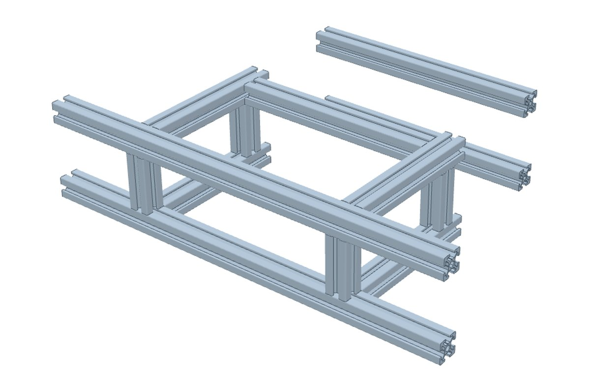
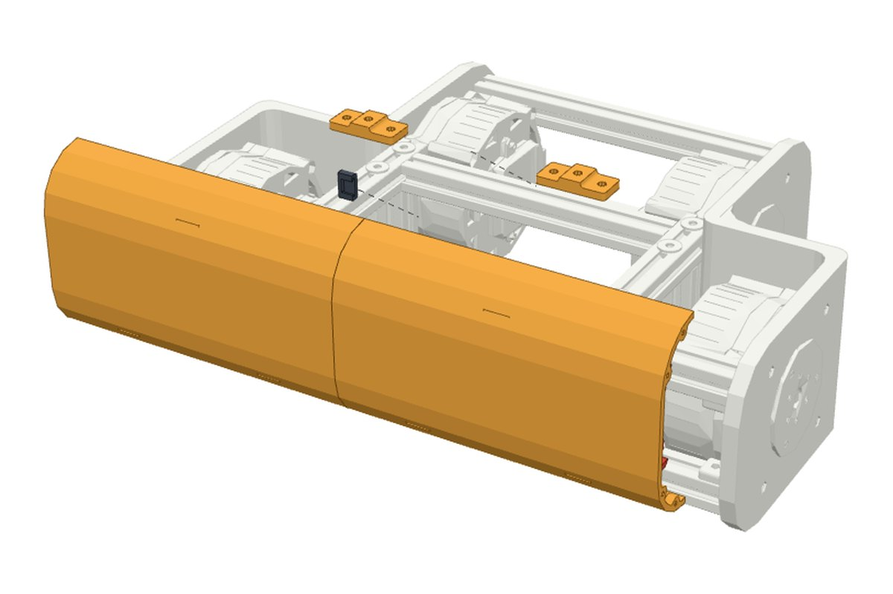
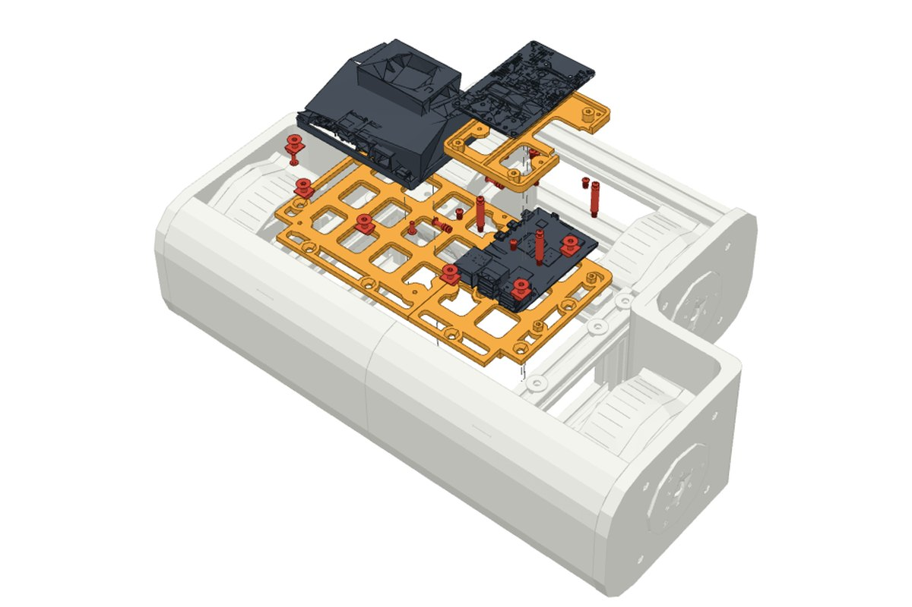
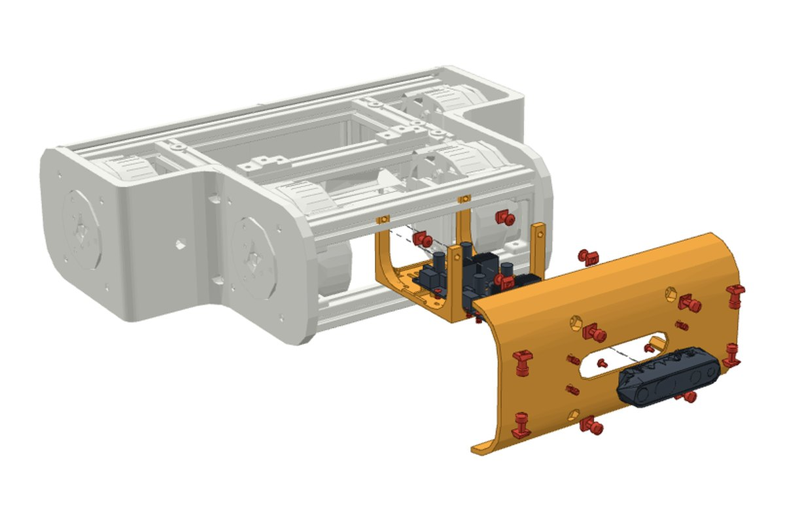
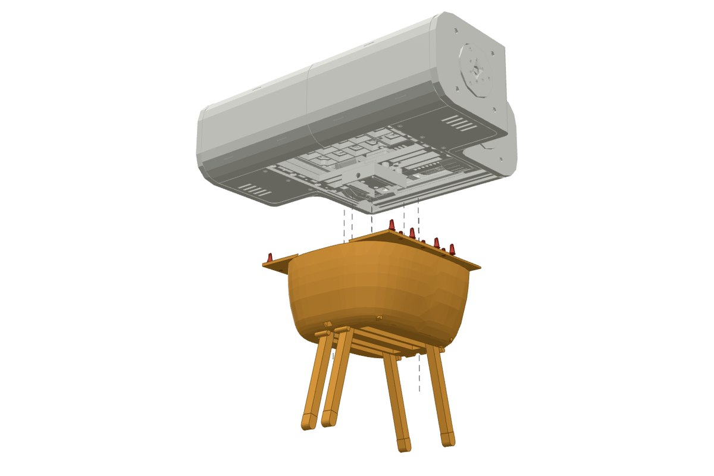
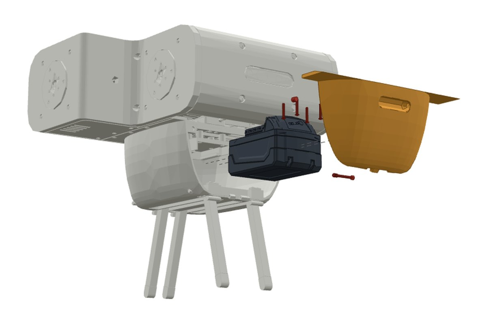
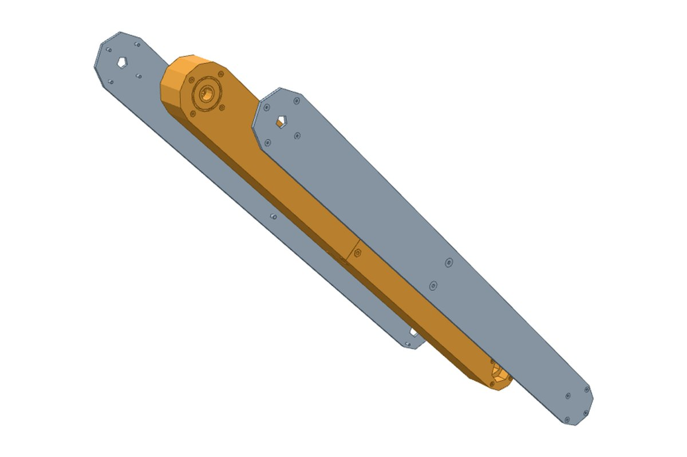
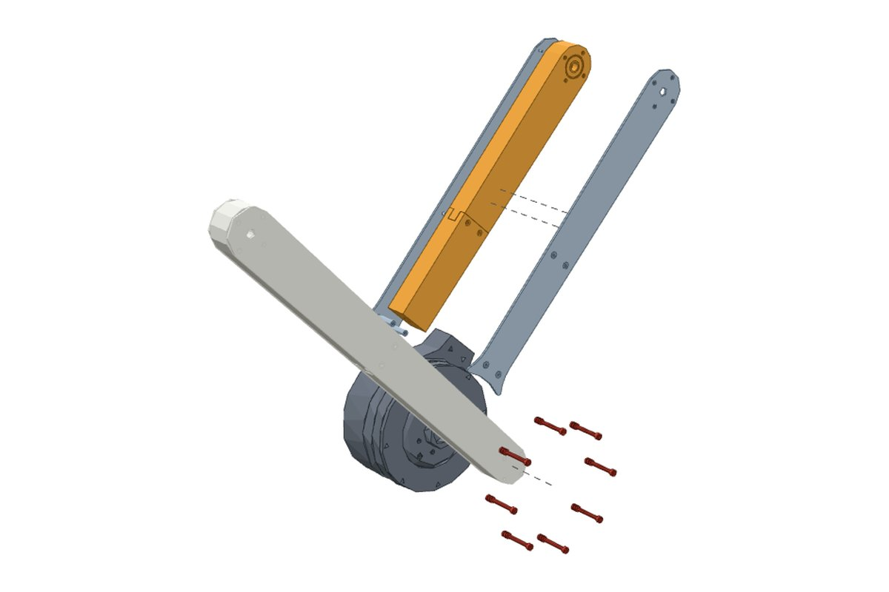

This guide follows the main Fusion 360 assembly of [PRIMUS](/portfolio/primus/). Each step lists the parts it adds and the hardware that holds them. The hardware is counted directly from the CAD: a screw belongs to the last step among the parts it touches. In the drawings, parts added in that step are coloured and pulled out along their assembly direction, and everything built earlier is light grey.

<figure class="project-figure assembly-legend">
  
  <figcaption>printed aluminium electronics actuators hardware. Directions in the text use the robot frame: X+ is the robot's right side, Y+ the front.</figcaption>
</figure>

The order below is one the parts allow, not a timed procedure. Torques, cable routing and wiring are not in the CAD and are not covered yet. Where the CAD leaves something open, such as how the aluminium profiles join each other, the step says so. Part names in parentheses are the component names in the Fusion file and in the exported STL files.

## Before you start

**Print the parts.** All printed parts are listed in the [bill of materials](#bill-of-materials). The CAD assigns PET (PETG), ABS to the arm cores, and a carbon-filled PA12 to the landing-gear struts and stops. The tyres are modelled as rubber.

**Install the heat-set inserts.** Brass inserts go into the printed parts before assembly: 41 × M3 × 5.7 mm (OD 4.6), 12 × M3 × 5.7 mm (OD 5), 16 × M3 × 6 mm (OD 5), 4 × M3 × 4 mm and 8 × M2.5 × 4 mm. Each step lists the inserts its parts carry.

**Build the six actuators.** PRIMUS uses actuators derived from Aaed Musa's [OpenQDD V1](https://github.com/aaedmusa/OpenQDD-V1), a 3D-printed quasi-direct-drive actuator with a 9:1 helical planetary gearbox. PRIMUS keeps the 9:1 ratio but uses a stronger, modified printed gearbox, a 130 kV motor and mjbots moteus-r4 controllers at 24 V. Four are hip actuators and two drive the wheels; the wheel version has a larger output housing. Build them following the [OpenQDD instructions](https://www.instructables.com/OpenQDD-V1-3D-Printed-Robotic-Actuator) with the PRIMUS parts. On the hip actuators, the four M4 screws that close the housing are 45 mm long so they continue through the hip box in step 2.

**Tools.** Hex keys of 1.3, 2, 2.5, 3 and 4 mm (countersunk M2 to M5 and the socket-head screws), and a soldering iron with an insert tip.

<ol class="assembly-steps">
<li class="assembly-step" id="step-1">
<h2>Frame</h2>

The frame is thirteen 20×20 aluminium profiles: 2 × 400 mm, 2 × 228 mm, 1 × 188 mm, 4 × 140 mm and 4 × 53 mm. The CAD does not model the joints between profiles, so use the method you prefer for 2020 extrusion.

<strong>Hardware.</strong> 2 × M5 drop-in T-nuts (2020, slot 6), placed in the slots now.

</li>

<li class="assembly-step" id="step-2">
<h2>Hip boxes and hip actuators</h2>

Each side of the robot has one printed hip box (Caixa do quadril X+ and X−) that carries two hip actuators, the front one and the rear one, 140 mm apart. Fix each actuator into its box with the long M4 screws from the actuator build, then fix the boxes to the ends of the frame.

Drop all the T-nuts for this step into the profile slots now. Several of them only receive their screws later, with the belly in step 7.

<strong>Hardware.</strong> 10 × M5 drop-in T-nuts, 4 × M5 × 10 socket head (ISO 4762), 6 × washers 5.3 × 15 × 1.2.

</li>

<li class="assembly-step" id="step-3">
<h2>Rear covers and upper supports</h2>

Close the back of the body with the two halves of the rear cover (Tampa Y− metade X+ and X−). The printed upper supports (Suportes superiores) bridge the top of the frame and later hold the magnetic top covers. The small Orin support (Suporte pequeno Orin) and the six small magnet holders on the rear face of the frame (Magnet holder) also go in here.

<strong>Hardware.</strong> 4 × M5 drop-in T-nuts, 4 × M5 × 10 socket head, 2 × washers 5.3 × 15 × 1.2.

</li>

<li class="assembly-step" id="step-4">
<h2>Electronics tray</h2>

The electronics tray (Base eletronica v2) is printed in two parts and screws to the frame from above. On it go the Jetson Orin Nano in its case, the Raspberry Pi 5 on 20 mm standoffs, and the power distribution board on its printed bridge (Ponte da placa de energia).

<strong>Hardware.</strong> 7 × M5 × 10 countersunk (DIN 7991) with 7 × M5 T-nuts for the tray; 4 × M2.5 × 20 male–female brass standoffs, 8 × M2.5 × 4 inserts, 4 × M2.5 × 6 and 4 × M2.5 × 5 button head for the Raspberry Pi and the power board; 4 × M3 × 8 button head for the Orin case; 2 × M3 × 12 button head and 2 × M3 × 5.7 inserts joining the two tray halves.

</li>

<li class="assembly-step" id="step-5">
<h2>Converters and front cover with the camera</h2>

Mount the two XL4016 buck converters on their printed shelf (Prateleira dos conversores XL4016) and fix the shelf to the front of the frame. The RealSense D435i goes on its bracket (Suporte da RealSense), the bracket goes on the front cover (Tampa frontal Y+), and the cover closes the front of the body.

<strong>Hardware.</strong> 12 × M5 drop-in T-nuts, 8 × M5 × 10 socket head and 4 × M5 × 10 button head (ISO 7380); 10 × M3 × 6 button head, 4 × M3 × 8 button head and 12 × M3 × 5.7 inserts for the converters, the camera and its bracket.

</li>

<li class="assembly-step" id="step-6">
<h2>Lower frame, IMU and battery shoe</h2>

Turn the body over. The printed lower frame (Quadro inferior) comes in two halves with mitred ends. It carries the WitMotion WT901C IMU and the shoe that receives the M18 battery (Receptor M18 – sapata). The two lower side covers (Tampa inferior lateral X+ and X−) close the sides under the hip boxes.

<strong>Hardware.</strong> 8 × M5 drop-in T-nuts; 6 × M3 × 8 countersunk, 2 × M3 × 8 button head (IMU), 8 × M3 × 5.7 inserts and 4 × M3 × 4 inserts.

</li>

<li class="assembly-step" id="step-7">
<h2>Belly and retractable landing gear</h2>

The organic belly (Barriga organica) is the lower shell of the body and carries the retractable landing gear. Each strut is driven by an MG90S servo: the front one through the servo horn and a 76.5 mm M2 tie-rod, the rear one through a printed crank. The four printed stops (Batentes do trem) limit the travel, and two TPU plugs close the holes used to insert the strut axles. Build the gear into the belly, then fix the belly under the body.

<strong>Hardware.</strong> 8 × M5 × 12 button head through the belly into the frame; 4 × self-tapping 2 × 8 pan head for the servos; 4 × M3 × 10 button head, 6 × M3 × 10 countersunk, 4 × M3 × 8 countersunk and 14 × M3 × 5.7 inserts.

</li>

<li class="assembly-step" id="step-8">
<h2>Battery and battery door</h2>

The Milwaukee M18 5 Ah battery slides into the shoe from the front, and the front door of the belly (Tampa frontal da barriga) closes over it. The door is held by four small magnets.

<strong>Hardware.</strong> 4 × N52 magnets Ø6 × 3; 4 × M3 × 20 button head (battery shoe to lower frame), 4 × M3 × 10 button head, 1 × M3 × 30 socket head and 5 × M3 × 5.7 inserts.

</li>

<li class="assembly-step" id="step-9">
<h2>Hip arms</h2>

Each of the four hip arms is a printed ABS core (Component495) between an outer and an inner 2 mm aluminium plate (Outer and Inner sheet metal), joined by brass standoffs. Two arms are built as drawn and two are mirrored (upper arm espelhado).

<strong>Hardware, for all four arms.</strong> 16 × M4 × 27 female–female brass standoffs, 32 × M4 × 8 countersunk.

</li>

<li class="assembly-step" id="step-10">
<h2>Arms on the hip actuators</h2>

Fix each arm to the output of its hip actuator. The two M12 × 1.5 cable glands sit in the hip boxes, next to the front arms.

<strong>Hardware.</strong> 24 × M3 × 12 countersunk, six per arm into the actuator output; 2 × M12 × 1.5 cable glands.

</li>

<li class="assembly-step" id="step-11">
<h2>Rear lower links</h2>

Each rear lower link is a printed core (Component3) between two aluminium plates (Component2 and Component4). Two 608-2RS bearings go into the core for the knee shaft before the plates are closed.

<strong>Hardware, for both links.</strong> 4 × 608-2RS bearings (8 × 22 × 7); 16 × M2 × 22 and 4 × M3 × 22 female–female brass standoffs; 32 × M2 × 6 and 8 × M3 × 6 countersunk.

</li>

<li class="assembly-step" id="step-12">
<h2>Shins and wheel actuators</h2>

The shin is built the same way: a printed core (Component9) between two aluminium plates (Component8 and Component10), with two 608-2RS bearings for the knee. The wheel actuator is screwed to the lower end of the shin, which is why the shin carries most of the leg's mass.

<strong>Hardware, for both shins.</strong> 4 × 608-2RS bearings; 8 × M2 × 22 and 8 × M3 × 22 female–female standoffs; 16 × M2 × 6 and 16 × M3 × 6 countersunk; 16 × M3 × 30 socket head and 16 × M3 × 6 inserts (OD 5) for the wheel actuators.

</li>

<li class="assembly-step" id="step-13">
<h2>Wheels and the closing joint</h2>

The wheel bolts to the output of the wheel actuator. At the same axle the rear lower link meets the shin, which closes the five-bar loop. The bearings at this joint are 12 × 28 × 8 mm.

<strong>Hardware, for both wheels.</strong> 4 × 12 × 28 × 8 mm bearings; 12 × M3 × 30 low-head socket screws (DIN 7984); 12 × M3 × 8 countersunk with 12 × M3 × 5.7 inserts (OD 5).

</li>

<li class="assembly-step" id="step-14">
<h2>Lower legs on the robot</h2>

Bring each finished lower leg to its side of the robot, lining the knee bearings of the rear link and the shin up with the ends of the hip arms.

</li>

<li class="assembly-step" id="step-15">
<h2>Knee shafts</h2>

Slide a Ø8 × 50 mm steel shaft through each knee, one per arm, and lock it with a shaft collar on each side. The knees are passive, so check that every leg folds and extends freely before going on.

<strong>Hardware.</strong> 4 × Ø8 × 50 mm shafts, 8 × Ø8 shaft collars with M4 set screws.

</li>

<li class="assembly-step" id="step-16">
<h2>Top covers and lidar</h2>

The four top covers (Tampa superior dianteira and traseira, X+ and X−) are held by magnets, so the electronics stay reachable. The RPLIDAR A1 sits on the two front covers.

<strong>Hardware.</strong> 8 × N52 magnets Ø10 × 3; 8 × M5 × 6 button head.

</li>
</ol>

After step 16 the robot is complete. It starts parked on its landing gear, and the [operating notes](/portfolio/primus/#operating-primus) describe how it stands up.

## Bill of materials

Quantities are for one robot and come from the Fusion 360 assembly. The parts inside the actuators are covered by the OpenQDD bill of materials.

### Printed parts

| Part (CAD name) | Qty | Material in the CAD |
|---|---:|---|
| Hip box (Caixa do quadril X+, X−) | 1 + 1 | PETG |
| Rear cover halves (Tampa Y− metade X+, X−) | 1 + 1 | PETG |
| Upper supports (Suportes superiores) | 1 | PETG |
| Small Orin support (Suporte pequeno Orin) | 1 | PETG |
| Magnet holder | 6 | PETG |
| Electronics tray, two parts (Base eletronica v2) | 1 | PETG |
| Power board bridge (Ponte da placa de energia) | 1 | PETG |
| Converter shelf (Prateleira dos conversores XL4016) | 1 | PETG |
| Front cover (Tampa frontal Y+) | 1 | PETG |
| Camera bracket (Suporte da RealSense) | 1 | PETG |
| Lower frame, two halves (Quadro inferior) | 1 | PETG |
| Battery shoe (Receptor M18 – sapata) | 1 | PETG |
| Lower side covers (Tampa inferior lateral X+, X−) | 1 + 1 | PETG |
| Top covers (Tampa superior dianteira / traseira, X+ and X−) | 4 | PETG |
| Belly (Barriga organica) | 1 | PETG |
| Battery door (Tampa frontal da barriga) | 1 | PETG |
| Front and rear landing-gear struts (Trem dianteiro, Trem traseiro) | 1 + 1 | PA12-CF and PETG |
| Landing-gear stops (Batentes do trem) | 4 | PA12-CF |
| Rear gear crank (Manivela traseira) | 1 | PETG |
| Axle-hole plugs (Tampões) | 2 | TPU |
| Arm core (Component495) | 4 | ABS |
| Rear link core (Component3) | 2 | PETG |
| Shin core (Component9) | 2 | PETG |
| Wheel side disc (Body6 in the lower-leg component) | 2 | PETG |
| Printed parts of the six actuators | | see OpenQDD |

### Aluminium

| Part | Qty |
|---|---:|
| 20×20 profile, 400 mm | 2 |
| 20×20 profile, 228 mm | 2 |
| 20×20 profile, 188 mm | 1 |
| 20×20 profile, 140 mm | 4 |
| 20×20 profile, 53 mm | 4 |
| Arm outer plate, 2 mm (Outer sheet metal) | 4 |
| Arm inner plate, 2 mm (Inner sheet metal) | 4 |
| Rear link plates (Component2, Component4) | 2 + 2 |
| Shin plates (Component8, Component10) | 2 + 2 |

### Electronics and purchased parts

| Part | Qty |
|---|---:|
| Hip actuator, OpenQDD-derived, 9:1 | 4 |
| Wheel actuator, OpenQDD-derived, 9:1 | 2 |
| mjbots moteus-r4 controller (one per actuator) | 6 |
| NVIDIA Jetson Orin Nano developer kit, with case | 1 |
| Raspberry Pi 5 | 1 |
| Power distribution board, 50 × 80 mm, XT90 input and six XT30 outputs | 1 |
| XL4016 buck converter, 300 W | 2 |
| Intel RealSense D435i | 1 |
| Slamtec RPLIDAR A1 | 1 |
| WitMotion WT901C-TTL IMU | 1 |
| MG90S servo | 2 |
| Milwaukee M18 battery, 5 Ah | 1 |
| Tyre, Ø 215 mm (rubber in the CAD) | 2 |
| Cable gland M12 × 1.5 with locknut | 2 |

### Bearings, shafts and magnets

| Part | Qty |
|---|---:|
| 608-2RS bearing, 8 × 22 × 7 mm (knees) | 8 |
| 12 × 28 × 8 mm bearing (wheel axle and closing joint) | 4 |
| Steel shaft Ø8 × 50 mm | 4 |
| Shaft collar Ø8, M4 set screw | 8 |
| N52 magnet Ø10 × 3 mm | 8 |
| N52 magnet Ø6 × 3 mm | 4 |

### Fasteners

| Fastener | Qty |
|---|---:|
| M5 drop-in T-nut for 2020 profile (slot 6) | 43 |
| M5 × 10 socket head (ISO 4762) | 16 |
| M5 × 10 countersunk (DIN 7991) | 7 |
| M5 × 12 button head (ISO 7380) | 8 |
| M5 × 10 button head | 4 |
| M5 × 6 button head | 8 |
| Washer 5.3 × 15 × 1.2 | 8 |
| M4 × 8 countersunk | 32 |
| M4 × 27 female–female brass standoff | 16 |
| M3 × 30 socket head | 17 |
| M3 × 30 low-head socket (DIN 7984) | 12 |
| M3 × 12 countersunk | 24 |
| M3 × 10 countersunk | 6 |
| M3 × 8 countersunk | 22 |
| M3 × 6 countersunk | 24 |
| M3 × 20 button head | 4 |
| M3 × 12 button head | 2 |
| M3 × 10 button head | 8 |
| M3 × 8 button head | 10 |
| M3 × 6 button head | 10 |
| M3 × 22 female–female brass standoff | 12 |
| M2.5 × 6 button head | 4 |
| M2.5 × 5 button head | 4 |
| M2.5 × 20 male–female brass standoff | 4 |
| M2 × 6 countersunk | 48 |
| M2 × 22 female–female brass standoff | 24 |
| Self-tapping 2 × 8 pan head | 4 |
| Heat-set insert M3 × 5.7, OD 4.6 | 41 |
| Heat-set insert M3 × 5.7, OD 5 | 12 |
| Heat-set insert M3 × 6, OD 5 | 16 |
| Heat-set insert M3 × 4, OD 4.6 | 4 |
| Heat-set insert M2.5 × 4, OD 3.5 | 8 |
