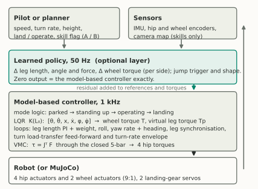
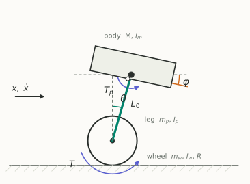
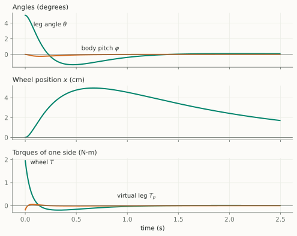
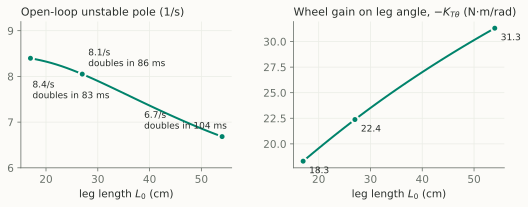
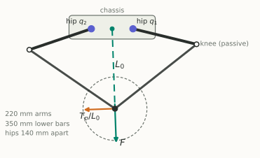
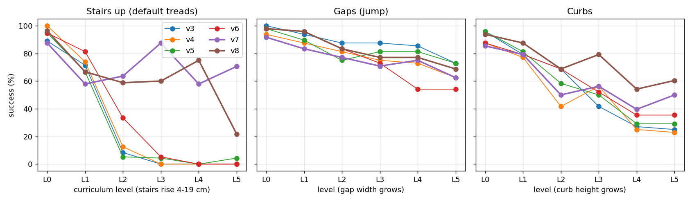
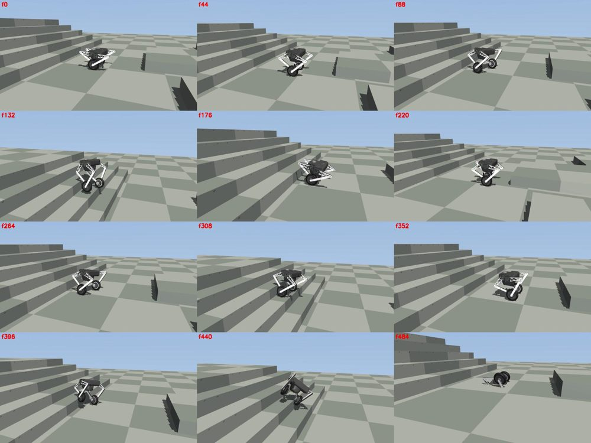
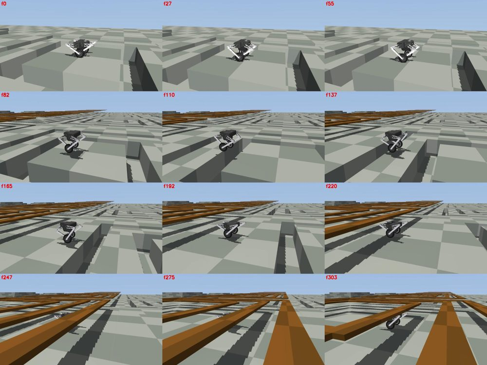
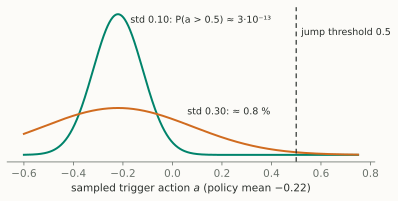
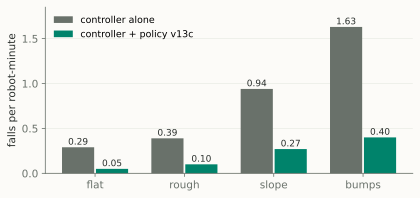

This page goes through how PRIMUS balances and how the learned policies on top of it were built: the physics of the robot, the model-based controller with its equations, and the reinforcement-learning experiments that came after it. The code is in the [PRIMUS repository](https://github.com/roandr694/PRIMUS), mainly in `control/` and `sim/warp_rl/`.

Every result on this page comes from simulation. The controller runs in MuJoCo on the model generated from the CAD, and the policies were trained and evaluated in MuJoCo Warp on a GPU. The motor numbers are estimates until the actuators are characterised, so all of this is still "simulation only" until it runs on the built robot.

<figure><figcaption>The control stack. The model-based controller alone balances and drives the robot. The learned policy is an optional layer whose output is added to the controller's references and torques; with a zero output the robot runs exactly the model-based controller.</figcaption></figure>

## Why a wheel-legged robot falls over

PRIMUS stands on two wheels with its mass above the axles, so it is an inverted pendulum. To see how fast it falls, take the simplest version: a point mass on a massless rod of length $L$, hinged at a fixed point on the ground. If $\theta$ is the angle from vertical, gravity gives

$$
\ddot\theta = \frac{g}{L}\sin\theta \approx \frac{g}{L}\,\theta
$$

for small angles. The solution grows like $e^{\lambda t}$ with $\lambda = \sqrt{g/L}$. For $L = 0.27$ m, the nominal leg length, $\lambda = \sqrt{9.81/0.27} \approx 6.0$ s⁻¹. A small lean doubles every $\ln 2/\lambda \approx 115$ ms. Nothing in the robot can wait several hundred milliseconds to react, so the balance loop runs at 1 kHz.

The way to recover is the same as balancing a broom on a hand: move the support under the mass. PRIMUS does that by driving its wheels. It also has a second way to act, which a plain two-wheeled robot lacks. Each leg is a closed five-bar linkage with two hip motors, so the robot can change the length of its legs and swing them forward or back relative to the body. That makes the model richer, and it is why the controller is built in layers.

## A planar model of half the robot

When the robot drives straight with both legs alike, the left and right sides do the same thing. The controller is therefore designed on a planar model of half of the robot: one wheel, one leg of variable length and half of the body. This idea, and the structure of the equations, come from the `sys_calc.m` script in the open-source [wheel-legged robot by Skythinker616](https://github.com/Skythinker616/foc-wheel-legged-robot); `control/lqr_design.py` is a port of it, with the parameters of PRIMUS.

<figure><figcaption>The half-robot model used for the balance design. The leg is the "virtual leg", the straight line from the midpoint between the two hips to the wheel axle; the real five-bar sits behind it and is handled separately (below).</figcaption></figure>

The model has six state variables, collected in

$$
\mathbf{x} = \begin{bmatrix} \theta & \dot\theta & x & \dot x & \varphi & \dot\varphi \end{bmatrix}^\top
$$

- $\theta$ is the angle of the virtual leg from vertical, positive with the hip ahead of the wheel;
- $x$ is the distance the wheel has rolled, and $\dot x$ the forward speed;
- $\varphi$ is the pitch of the body, positive nose up.

The two inputs are $\mathbf{u} = [T,\ T_p]^\top$: $T$ is the torque of one wheel motor, and $T_p$ is a virtual torque between the leg and the body at the hip. Nothing on the robot produces $T_p$ directly; the five-bar hip motors produce it together, as described further down.

The physical parameters are taken from the MuJoCo model with the five-bar actually posed at each leg length. Because the wheel motor sits on the shin, most of the leg's mass is near the wheel, which matters for the gains.

| at leg length $L_0$ | 0.17 m | 0.27 m | 0.54 m |
|---|---:|---:|---:|
| wheel axle → leg centre of mass, $L$ | 0.098 m | 0.115 m | 0.196 m |
| leg centre of mass → hip, $L_m$ | 0.072 m | 0.155 m | 0.344 m |
| leg inertia about its centre of mass, $I_p$ | 0.084 kg·m² | 0.091 kg·m² | 0.103 kg·m² |

The other parameters do not depend on leg length: leg mass $m_p = 2.66$ kg, half body mass $M = 3.87$ kg with $I_m = 0.039$ kg·m², wheel mass $m_w = 1.31$ kg with $I_w = 0.014$ kg·m² (including the reflected inertia of the motor rotor), wheel radius $R = 0.1075$ m. The body's centre of mass sits $l = 2.1$ cm below the hip. Twice the per-side masses gives the 15.7 kg of the CAD.

### The equations of motion

The equations come from Newton's laws applied to each of the three bodies, with the internal forces written out. Call $N$ and $P$ the horizontal and vertical forces that the leg exerts on the wheel at the axle, and $N_m$, $P_m$ the forces between the leg and the body at the hip. Writing $a = \ddot x$, $b = \ddot\theta$ and $c = \ddot\varphi$, the body's horizontal and vertical motion fixes the hip forces:

$$
\begin{aligned}
N_m &= M\left[a + (L + L_m)\left(b\cos\theta - \dot\theta^2\sin\theta\right) - l\left(c\cos\varphi - \dot\varphi^2\sin\varphi\right)\right] \\
P_m &= Mg + M\left[(L + L_m)\left(-\dot\theta^2\cos\theta - b\sin\theta\right) - l\left(\dot\varphi^2\cos\varphi + c\sin\varphi\right)\right]
\end{aligned}
$$

Adding the leg's own mass gives the forces at the axle:

$$
\begin{aligned}
N &= N_m + m_p\left[a + L\left(b\cos\theta - \dot\theta^2\sin\theta\right)\right] \\
P &= P_m + m_p g + m_p L\left(-\dot\theta^2\cos\theta - b\sin\theta\right)
\end{aligned}
$$

Then each body gets one rotational equation. The wheel turns under its motor torque and the horizontal axle force; the leg turns under the forces at both ends and the two torques; the body turns under $T_p$ and the hip forces:

$$
\begin{aligned}
a &= \frac{T - N R}{I_w/R + m_w R} \\
I_p\, b &= (P L + P_m L_m)\sin\theta - (N L + N_m L_m)\cos\theta - T + T_p \\
I_m\, c &= T_p + N_m\, l\cos\varphi + P_m\, l\sin\varphi
\end{aligned}
$$

These are three equations in the three accelerations $a$, $b$, $c$. The design script solves them numerically for any state and input, which is all the next step needs.

## Linearising the model and designing the LQR

### Linearisation

Near the upright pose the angles and speeds are small, so the nonlinear model can be replaced by its first-order Taylor expansion around $\mathbf{x} = 0$, $\mathbf{u} = 0$:

$$
\dot{\mathbf{x}} = A\,\mathbf{x} + B\,\mathbf{u}
$$

$A$ (6×6) says how the state changes on its own, and $B$ (6×2) how the inputs push it. The script fills them by finite differences: it nudges each state and input by $10^{-6}$ and measures the change in the accelerations. At $L_0 = 0.27$ m the rows that matter are

$$
\begin{aligned}
\ddot\theta &= 65.0\,\theta + 0.97\,\varphi - 11.6\,T + 3.70\,T_p \\
\ddot x &= -9.55\,\theta + 0.04\,\varphi + 2.75\,T - 0.77\,T_p \\
\ddot\varphi &= -15.9\,\theta - 20.1\,\varphi + 0.76\,T + 23.8\,T_p
\end{aligned}
$$

The eigenvalues of $A$ say what the robot does with no control. They are $\pm 8.05$ s⁻¹, $\pm 4.47i$ s⁻¹ and a double zero. The $+8.05$ is the fall: a lean doubles in 86 ms, faster than the 115 ms of the point-mass pendulum, because the wheel rolls back as the leg tips forward. The imaginary pair is the body swinging about the hip like an ordinary pendulum, since its centre of mass hangs below the hip: the term $\ddot\varphi = -20.1\varphi$ is a stable oscillation. The double zero is the position: the robot has no preferred place on the floor.

### Discretisation

The controller runs every $\Delta t = 1$ ms and holds its output constant in between. Over one step the continuous model becomes exactly

$$
\begin{gathered}
\mathbf{x}_{k+1} = G\,\mathbf{x}_k + H\,\mathbf{u}_k \\
G = e^{A\Delta t},\qquad H = \int_0^{\Delta t} e^{A s}\,ds\; B
\end{gathered}
$$

Both come from one matrix exponential of a block matrix, $\exp\!\left(\begin{bmatrix} A & B \\ 0 & 0\end{bmatrix}\Delta t\right) = \begin{bmatrix} G & H \\ 0 & I\end{bmatrix}$.

### The LQR

A linear-quadratic regulator chooses a feedback $\mathbf{u}_k = -K\,\mathbf{x}_k$ that minimises the infinite sum

$$
J = \sum_{k=0}^{\infty} \left( \mathbf{x}_k^\top Q\, \mathbf{x}_k + \mathbf{u}_k^\top R\, \mathbf{u}_k \right)
$$

$Q$ and $R$ are diagonal weights: a large entry in $Q$ makes that state expensive to leave at a non-zero value, and a large entry in $R$ makes that input expensive to use. For PRIMUS

$$
\begin{gathered}
Q = \operatorname{diag}(10,\ 4,\ 40,\ 80,\ 600,\ 10) \\
R = \operatorname{diag}(4,\ 4)
\end{gathered}
$$

so the body pitch $\varphi$ is the most protected quantity (600), followed by speed and position. The optimal gain comes from the solution $P$ of the discrete algebraic Riccati equation,

$$
\begin{aligned}
P &= Q + G^\top P G - G^\top P H\left(R + H^\top P H\right)^{-1} H^\top P G \\
K &= \left(R + H^\top P H\right)^{-1} H^\top P G
\end{aligned}
$$

which `scipy.linalg.solve_discrete_are` solves. At $L_0 = 0.27$ m the result is

$$
K = \begin{bmatrix}
-22.4 & -3.81 & -3.06 & -6.00 & 0.94 & 0.33 \\
\phantom{-}2.09 & \phantom{-}0.51 & \phantom{-}0.58 & \phantom{-}1.08 & 11.1 & 1.80
\end{bmatrix}
$$

with the first row giving $T$ and the second $T_p$, and the columns in the order of $\mathbf{x}$.

A worked example makes the numbers concrete. Suppose the leg leans forward by $\theta = 5° = 0.0873$ rad with everything else at zero. Then $T = -(-22.4)(0.0873) = 1.95$ N·m on each wheel: the wheels drive forward, under the falling mass. At the same time $T_p = -(2.09)(0.0873) = -0.18$ N·m, a small torque that keeps the body level while the leg moves under it.

<figure><figcaption>Response of the linearised half-robot model at <i>L</i>0 = 0.27 m to a 5° initial leg lean, with the LQR gain above. This is a computation on the linear model only; the nonlinear robot in MuJoCo was tested separately (results further down). The wheel drives about 5 cm forward to catch the lean and then creeps back towards its start, the slowest closed-loop mode (about 0.7 s⁻¹).</figcaption></figure>

### Scheduling the gain on leg length

The legs change length between 0.18 and 0.52 m while the robot drives, and the model changes with them. A longer leg moves the mass higher and falls more slowly, but each degree of lean then puts the mass further from the wheel. A single gain designed at one length would be wrong at the others, so the design is repeated every centimetre from 0.17 to 0.54 m and each of the 12 gains is fitted with a cubic in $L_0$:

$$
K_{ij}(L_0) = c_{ij,3}\,L_0^3 + c_{ij,2}\,L_0^2 + c_{ij,1}\,L_0 + c_{ij,0}
$$

The robot evaluates the 48 coefficients at its measured leg length in every control step. The largest fit error is below 0.01 in absolute terms, under 0.3% of the gains.

<figure><figcaption>Left: the unstable eigenvalue of the linearised model at each leg length. Right: the strongest gain, from leg angle to wheel torque. Computed from the design script with the MJCF parameters; points mark 17, 27 and 54 cm.</figcaption></figure>

## From the virtual leg to the hip motors

The LQR speaks about a straight virtual leg, but the robot has a closed five-bar on each side. Two arms of 220 mm turn on hips 140 mm apart, and two lower bars of 350 mm meet at the wheel axle. The knees are passive. For a given pair of hip angles $q_1, q_2$ the position of the axle follows from closing the loop: each knee is placed by rotating its arm, and the axle is the intersection of two circles of radius 350 mm around the knees, taking the branch with the wheel below. `control/five_bar.py` does this analytically, which gives the virtual leg length $L_0$ and angle $\theta$ from the two hip encoders.

<figure><figcaption>One leg drawn from the analytic kinematics at <i>L</i>0 = 0.27 m. Virtual model control asks for a force <i>F</i> along the virtual leg and a torque <i>T</i>p about the hip, applied as a perpendicular force <i>T</i>p/<i>L</i>0 at the axle.</figcaption></figure>

The mapping back to the motors is virtual model control (VMC). The controller decides on a force at the wheel axle and the hip torques that produce it come from the principle of virtual work. If the hips turn by a small $\delta\mathbf{q}$, the axle moves by $\delta\mathbf{p} = J\,\delta\mathbf{q}$, where $J$ is the Jacobian of the axle position with respect to the hip angles. The work done by the motors has to equal the work done at the axle, $\boldsymbol\tau^\top \delta\mathbf{q} = \mathbf{F}^\top \delta\mathbf{p} = \mathbf{F}^\top J\,\delta\mathbf{q}$ for every $\delta\mathbf{q}$, so

$$
\boldsymbol\tau = J^\top \mathbf{F},
\qquad
\mathbf{F} = F\,\mathbf{e} + \frac{T_p}{L_0}\,\mathbf{e}_\perp
$$

with $\mathbf{e}$ the unit vector from the hip to the axle and $\mathbf{e}_\perp$ perpendicular to it. The knees are passive, so the Jacobian has to respect the closed loop: when the hips move, the knees move as the loop forces them to. If $C_h$ and $C_k$ are the Jacobians of the loop-closure error with respect to hips and knees, keeping the loop closed means $C_h\,\delta\mathbf{q}_h + C_k\,\delta\mathbf{q}_k = 0$, and the hip-only Jacobian is

$$
J = J_h + J_k\left(-C_k^{-1} C_h\right)
$$

The controller builds it at every step from MuJoCo's body Jacobians (on the robot, the same equations come from the analytic kinematics).

The force along the leg $F$ carries the robot's weight and controls height. It is the sum of a PI loop on leg length, a feed-forward of the weight carried by each leg and a correction for roll. The weight term is easy to estimate: one side has 6.53 kg above the wheel, so each leg pushes about $6.53 \times 9.81 \approx 64$ N to stand still.

## The loops around the LQR

The LQR handles balance in the sagittal plane. A few simpler loops handle everything else.

**Equilibrium.** The real centre of mass is 1.1 cm behind the hip and a slope shifts the balance point. A slow integral of the position error moves the zero of $\theta$ (limited to ±0.15 rad), so the robot settles at the lean that balances instead of rolling away from its target.

**Roll and height.** The two legs share the height command. A PD leveller adds force to one leg and removes it from the other to keep the body level, and when the ground is uneven the mean length target is shifted by half the leg difference, so that both legs stay inside 0.18–0.52 m. With one wheel on a 13° ramp and the legs high, the ramp leg retracts instead of the other one over-extending.

**Yaw and leg synchronisation.** Turning is a difference in wheel torques, with a feed-forward on the commanded yaw rate and a slow heading correction. The wheel torque difference also tends to swing one leg ahead of the other, so a synchronisation loop adds opposite $T_p$ to the two legs. Its gains scale with $(L_0/0.27)^2$, like the inertia of the leg about the hip; with fixed gains the tall legs oscillated against the yaw loop (22° of leg split peak-to-peak at 0.52 m and 1.5 rad/s, 0.3° after the change).

**Turning fast.** In a turn of speed $v$ and yaw rate $\omega$ the centripetal acceleration $a = v\,\omega$ moves load to the outer wheel. Balancing moments about the body gives the extra force the outer leg must carry,

$$
\Delta F = \frac{m\, a\, h_\text{com}}{d_\text{hips}}
$$

with the centre-of-mass height measured on the model, $h_\text{com} = 0.585\,L_0 + 0.112$ m, and the lateral distance between the legs $d_\text{hips} \approx 0.37$ m. At 1.5 m/s and 1.5 rad/s with the nominal legs, $a = 2.25$ m/s², $h_\text{com} = 0.27$ m and $\Delta F = 15.7 \times 2.25 \times 0.27 / 0.37 \approx 26$ N: the outer leg carries about 90 N and the inner one 38 N. The controller adds this term directly, and the body stays level within 0.1° instead of leaning out by 6–8°.

The same moment balance says when the inner wheel would lift off. The controller limits the commanded yaw rate so that the inner wheel keeps at least 20% of the weight:

$$
a_\text{max} = \frac{(0.5 - 0.2)\, g\, w}{1.25\, h_\text{com}}
$$

with $w$ the wheel track and 1.25 an effective-height factor measured from the tyre loads in simulation. That allows about 3.8 m/s² at $L_0 = 0.27$ m and 2.4 m/s² at 0.52 m, so it only limits the pilot when the robot is both tall and fast.

**Modes and the landing gear.** The robot starts parked, with the legs at 0.18 m and two landing-gear legs resting on the ground. When asked to operate it starts the LQR, raises the legs to 0.25 m and retracts the gear once it is still (pitch rate below 0.3 rad/s and speed below 0.1 m/s for 0.5 s). Landing reverses the sequence. The "still" test ignores the absolute pitch on purpose, because the equilibrium pitch depends on a centre of mass that is uncertain on the real robot.

## What the controller measures

The controller uses only signals the real robot has. Attitude and angular rates come from the IMU. The forward speed comes from the wheel encoders, corrected for the rotation of the shin, which also turns the wheel:

$$
\dot x = -R\left(\omega_\text{wheel} + \omega_\text{shin}\right)
$$

where $\omega_\text{shin}$ is the body pitch rate plus the shin's rate relative to the body from the five-bar kinematics. Ground contact is estimated by running VMC backwards: the measured hip torques give the force on the wheel by solving $\boldsymbol\tau = J^\top \mathbf{f}$ for $\mathbf{f}$, and the wheel counts as on the ground when the normal force stays above 15 N for 30 ms. In simulation the speed estimate is within about 0.04 m/s RMS of the truth, and the estimated normal force within about 5 N.

## Controller results in simulation

All of these run in MuJoCo with the CAD model, using the estimated sensor signals above.

| test | result |
|---|---|
| standing on flat ground | pitch peak-to-peak below 0.2° |
| speed steps of 0.5, 1.5 and −1.0 m/s | tracks, 10–20% overshoot, a hard brake stops in about 1 s |
| 80 N push for 0.1 s | recovers in about 1 s |
| height 0.18 ↔ 0.52 m, standing and while turning | no fall |
| one wheel on a 13° ramp, legs 0.22–0.52 m | body level within 0.2° |
| yaw steps and ±1.8 rad/s zig-zags at 1.5–2.0 m/s | no fall, roll at most 0.4° (6 of 10 fell before the turning terms) |
| parked → stand up → push → land | stands up in 1.9 s, lands in 3.3 s |
| IMU with noise and bias | no fall, pitch peak-to-peak 0.5° |

## Reinforcement learning, briefly

Reinforcement learning (RL) trains a policy $\pi_\theta(\mathbf{a}\mid\mathbf{o})$, here a neural network with weights $\theta$, that maps an observation $\mathbf{o}$ to an action $\mathbf{a}$. The environment answers each action with a reward $r_t$, and training adjusts $\theta$ to maximise the expected discounted return

$$
G_t = \sum_{k=0}^{\infty} \gamma^k\, r_{t+k}
$$

The discount $\gamma < 1$ sets how far ahead the policy cares; rewards further than about $1/(1-\gamma)$ steps away count little. The policies here act at 50 Hz, so $\gamma = 0.99$ is a horizon of about 100 steps, or 2 s, and $\gamma = 0.995$ about 4 s.

The algorithm is PPO (proximal policy optimisation), in the RSL-RL implementation. A second network, the critic $V_\phi(\mathbf{s})$, learns to predict the return from each state. The advantage $\hat A_t$ measures how much better an action turned out than the critic expected; it is estimated with GAE, a weighted sum of one-step errors $\delta_t = r_t + \gamma V(\mathbf{s}_{t+1}) - V(\mathbf{s}_t)$ with weight $(\gamma\lambda)^k$ and $\lambda = 0.95$. PPO then raises the probability of actions with positive advantage, but limits how far the policy moves in one update:

$$
\mathcal{L}(\theta) = \mathbb{E}_t\left[\min\left(\rho_t \hat A_t,\ \operatorname{clip}(\rho_t,\, 1-\epsilon,\, 1+\epsilon)\, \hat A_t\right)\right],
\qquad
\rho_t = \frac{\pi_\theta(\mathbf{a}_t\mid\mathbf{o}_t)}{\pi_{\theta_\text{old}}(\mathbf{a}_t\mid\mathbf{o}_t)}
$$

with $\epsilon = 0.2$. Each iteration collects 24 steps from every simulated robot, then makes 5 passes over the data in 4 mini-batches. The learning rate adapts so that the KL divergence between the old and the new policy stays near 0.01. Actions are sampled from a Gaussian around the network output, and its standard deviation $\sigma$ is how the policy explores.

## The first attempt: raw torques

The first RL run, in Isaac Sim, gave PPO direct control of the six motor torques and asked it to learn everything, balance included. It did not learn to balance. It lowered the landing gear and sat on it. The reward paid almost fully for a tilted robot, the termination was lenient and the gear's servo target was never set, so sitting was the best policy available. The lesson was broader than the bugs: with an LQR that already balances, learning balance from scratch wastes samples, invites the policy to exploit the simulator, and depends on actuator details that have not been measured.

## Residual RL on top of the controller

The second design keeps the controller and lets the policy add a residual to it, only while the robot is operating. Per leg, the policy adds a change in leg length (scale 0.08 m per unit action), a change in leg angle (0.25 rad) and an extra wheel torque (3 N·m). The mean of the two length changes sets the height and their difference rolls the body; the mean angle change shifts the LQR equilibrium and the difference lets one leg run ahead of the other.

The last layer of the policy network starts at zero. At the first iteration the action is exactly zero, the robot is exactly the model-based controller, and training only has to learn corrections. The exploration noise acts directly on a balancing robot, so its standard deviation is bounded to 0.05–0.3 and there is no entropy bonus; in the first try it grew to 0.66 and the share of falling robots went from 2% to 75%.

The actor sees only what the robot measures: IMU, leg length and angle from the hip encoders, wheel speeds, odometry, the commands and five frames of history, all with noise. The critic is only used during training, so it also gets privileged information: the true velocity, the height above the ground, a height map and the randomised parameters. This asymmetric setup lets the critic judge states accurately while the actor stays deployable.

The reward, per second of simulated time, is a sum of terms:

| term | weight | what it measures |
|---|---:|---|
| speed tracking | +3.0 | $\exp(-e_v^2/0.1)$, with $e_v$ the speed error in m/s |
| yaw-rate tracking | +1.5 | $\exp(-e_\omega^2/0.2)$ |
| height tracking | +0.5 | $\exp(-e_L^2/0.03^2)$, leg-length error in m |
| upright | −5.0 | squared tilt of the body (gravity seen in the body's horizontal axes) |
| roll and pitch rates, vertical speed | −0.05, −1.0 | shaking |
| residual size and rate of change | −0.02, −0.1 | stay close to the controller, act smoothly |
| motor torques | −2·10⁻⁴ | effort |
| landing gear touching the ground | −2.0 | the Isaac exploit |
| fall | −10 | once, when the episode ends |

Each robot gets random friction (0.5–1.25), chassis mass (±15%) and centre of mass (±2 cm), pushes of up to 0.6 m/s every 3–7 s, and 15% of episodes start parked so the stand-up phase is included. The terrain is one large grid of tiles (flat, rough, slopes up to 15°, waves, steps up to 5 cm, blocks) at six difficulty levels, with a curriculum that moves each robot up after it succeeds.

Training runs in MuJoCo Warp, the GPU version of MuJoCo, on the same CAD model. The controller was ported to a Warp kernel and checked against the numpy version step by step (wheel torques within 0.45%, hips within 2%). Physics and controller run together at 1 kHz inside one CUDA graph, 20 physics steps per policy step, for 4096 robots at once: about 45 000 policy steps per second on an RTX 5070, so 1500 iterations take about 50 minutes.

The result, on 2160 robots for 60 s each on a terrain generated with a different seed, with the same pushes and parameters for both:

| | controller alone | controller + residual |
|---|---:|---:|
| falls per robot-minute | 0.265 | 0.069 |
| speed error | 0.207 m/s | 0.094 m/s |

The residual was better on all 18 terrain groups, most on the hard steps (0.89 → 0.18 falls per minute). One caveat: the controller changed afterwards (the turning terms and the scaled synchronisation gains), and this policy was trained on the older one. It now makes the new controller worse, so it has to be retrained; the always-on skill policy below replaced it in the meantime.

## Skills: stairs, curbs, gaps and bars

The blind residual cannot climb stairs. The wheel radius is 10.75 cm and real stairs are about 17 cm high, and above roughly the wheel radius a step cannot be rolled over. The robot has no hip abduction, so it cannot lift one leg at a time either. It has to jump with both wheels. The skill policies add perception and that jump.

### A jump primitive in the controller

The first skill teacher, v1, had no special help. It learnt to go down stairs and cross small gaps, but went up only 4 cm steps reliably. Its exploration noise had collapsed to a standard deviation of 0.07, and a two-wheel jump is a coordinated pulse of leg extension and tuck that random noise does not stumble on. From v2 on the controller has a jump primitive: push both legs out at full force to 0.50 m, then tuck them to 0.20 m. The policy only decides when to start it, with one extra action that triggers the primitive when it exceeds 0.5, and later also the extension, push force and tuck length. Run alone on flat ground, the primitive lifts the wheels 23–29 cm with an 18–20 N·m motor limit.

### Teacher and student

The skill policy is trained as a teacher with privileged observations: a perfect height scan of the ground 1.5 m ahead, a scan of the ceiling for bars, the true velocity and the motor limits. A student that sees only the simulated camera map is distilled from it afterwards. The terrain tiles are 8 m long, with stairs, curbs, gaps, overhanging bars, hurdles and wide gaps at six levels each (stairs from 4 to 19 cm). Success means covering 2.5 m without falling.

<figure><figcaption>Success by level for teachers v3–v8, from the project's experiment log (measured with about 20 robots per cell, which turned out to be too few; see below).</figcaption></figure>

The versions taught a sequence of lessons.

**Simulator freedom flatters results.** Teacher v7, trained from scratch with separate encoders for the scan, ceiling and privileged inputs, climbed 13 cm stairs best so far. Its videos showed why: an upper arm turning a full circle because the hips had no joint limits, legs split 60° apart, and jumps at about 675 W from an ideal motor. v8 added the hip limits from the CAD, a motor model (torque limit drawn per robot between 18 and 25 N·m with speed droop, 1–4 ms torque lag, 0–10 ms action delay, a 500–900 W battery limit and gearbox friction) and costs on power and leg split. The motions became plausible, with peak power 340–380 W, and success on 19 cm stairs dropped from 71% to 22%.

<figure class="primus-pair"><figcaption>MuJoCo frames of teacher v8: it fails the 19 cm stairs (left) and crosses a 45 cm gap (right).</figcaption></figure>

**Rare coordinated actions are hard to explore.** v8 never used the jump. The trigger's mean output had drifted to −0.22, and with the standard deviation at its floor of 0.10 the threshold of 0.5 sat $(0.5 + 0.22)/0.10 = 7.2$ standard deviations away. The probability of a sample above it is about $3\times10^{-13}$. With 4096 robots at 50 Hz, about $2\times10^{5}$ samples per second, the jump would fire by chance about once every six months of training.

<figure><figcaption>Illustration of the exploration problem with the numbers measured on v8: the same mean with the standard deviation at 0.10 and at 0.30. The curves are computed Gaussians, not samples from the policy.</figcaption></figure>

v9 tried to fix this by injecting the trigger in a few percent of steps near step edges. The first runs crashed with NaN weights: the injected samples were so unlikely under the policy that the ratio $\rho_t = e^{\Delta \log\pi}$ reached $10^5$, and PPO's clip only bounds the ratio on one side for negative advantages. Capping the log-ratio stopped the crashes, and the evaluation then showed a large gain on stairs.

**Evaluate with enough robots.** That gain was noise. v9 had been evaluated with about 20 robots per terrain cell. A success rate near 50% measured on $n$ robots has a standard error of $\sqrt{p(1-p)/n}$, which is 11 percentage points for $n = 20$ and 4 points for $n = 150$. Re-evaluated with about 190 robots per cell, v9 never fired the jump at all (the injection had pushed the trigger output down to −16 … −54), and its gap "regression" was refusal: 93% of the robots stopped about 1 m before a 45 cm trench. v9 was discarded, the evaluation moved to 150+ robots per cell with success, falls and refusals counted separately, and v7, which does jump, was continued on the realistic motors as v10. v10 and v11 climbed 16–19 cm stairs 91–98% of the time, and v11 handled walled flights of 12 steps.

**Only real time limits are time-outs.** v12 merged the assist and skill policies into one network that always runs, with a flag that switches between riding (jump off, rewarded for riding like the LQR) and skills (planner commands, jump on). Its first run diverged: the critic's loss doubled every ~150 iterations and the policy stopped climbing. The end of a successful flight had been reported as a time-out, and RSL-RL bootstraps a time-out with the value of the current state, adding $\gamma V(\mathbf{s}_t)$ to the reward. On the step that pays the climb and finish bonus, about 18, that makes $V = r + \gamma V$, whose fixed point is

$$
V = \frac{r}{1 - \gamma} = \frac{18}{1 - 0.995} = 3600
$$

The critic predicted up to 1180 on those states and the advantages turned into noise. Reporting success as a true terminal fixed it.

**Symmetry has to be imposed.** Every teacher up to v11 stood with one leg about 15° ahead of the other and a 12 cm length difference, cancelled by about 105 N of opposite leg forces. The side was arbitrary and changed between runs; nothing in PPO ties left and right together. v12 adds mirrored copies of each sample and a loss that asks the policy to act as the mirror image of itself on mirrored observations, and writes the actions as common and differential pairs. The stagger went from 12° to under 1° in assist.

**The learning rate was stuck at its floor.** v12 plateaued after about 2500 iterations. For two Gaussians with the same standard deviation the KL divergence is $(\Delta\mu)^2 / (2\sigma^2)$, so at the learnt $\sigma \approx 0.10$ a mean shift of only $0.10\sqrt{2 \times 0.01} \approx 0.014$ per action already reaches the KL target of 0.01, and the adaptive schedule keeps the learning rate near $10^{-5}$. This is an open item for the next recipe (a floor on $\sigma$, a larger KL target or a fixed rate).

**The evaluation leaked into neighbouring tiles.** Evaluation robots drove straight for 18 s at 0.5–1.0 m/s, 9–18 m on an 8 m tile, so many falls happened on the next tile and counted against the wrong terrain. A policy that refused less reached the neighbours more often, so the protocol favoured refusing. Training had the same leak, which made stopping look safe. From v13 an episode ends when the robot leaves its tile, without bonus or penalty.

### The current policy

v13c is the policy to use now. In assist mode it rides like the controller (leg error 0.7 cm, a fraction of a degree of leg split, no jumps) and falls far less under strong pushes:

<figure><figcaption>Falls per robot-minute in assist mode with ±1 m/s pushes every 2–6 s, unseen terrain, random motors, 150 robots per cell, evaluated with the history order the robot uses.</figcaption></figure>

In skill mode, at the hardest levels it reaches (done %, levels 3 / 4 / 5):

| obstacle | v13c |
|---|---|
| gaps up to 45 cm | 95 / 96 / 94 (v13b) |
| curbs up to 20 cm | 81 / 83 / 80 |
| hurdles 15–24 cm | 73 / 78 / 54 |
| bars down to 42 cm free height, leg command ≤ 0.36 m | 99 / 99 / 86 |
| wide gaps 0.50–0.80 m | 81 / 29 / 0 |

A separate probe of what the plant can do, with the controller and the jump primitive alone, sets the limits: the wheels clear 23–25 cm with the weakest motor draw and 30–35 cm with the strongest. Hurdles of 24 cm and gaps of 0.7–0.8 m are at or beyond that, so the planner must never offer them. One more bug turned up while building the student: the history of three frames had been shifted twice in steps where any robot reset, so every teacher trained on $[t-1, t, t]$ while the robot builds $[t-2, t-1, t]$. Measured with the robot's order, v13c loses up to 30 points on some hurdle levels, and the next teacher trains with the fix.

### The camera student

The student is what would run on the robot. It gets a 72 × 72 elevation map with 4 cm cells, simulated per robot on the GPU from the RealSense D435i's field of view, with ray-marched occlusion, noise growing with the square of the depth, odometry drift, camera latency, missing pixels and blackouts. Its network replaces the privileged inputs with a 1-D convolution over the last second of observations. It is trained by DAgger: the student drives, the teacher labels what it would have done in the states the student actually reaches, and the student regresses to those labels with the jump trigger weighted three times. Early on the teacher drives a share of the episodes, falling from all to none over 300 iterations, so the student sees the middle of the skills before it can reach them itself.

student-v1, distilled from v13c, stays within a few points of its teacher on riding, stairs, bars and gaps up to 45 cm, and falls behind on the hardest hurdles, wide gaps and long or narrow stairs. A recurrent (GRU) student lost to the 1 s convolution everywhere. Through the full CPU stack, rendered depth to map to planner to policy, it descends stairs, crosses gaps and passes under bars.

A separate small policy stands the robot up after a fall, from lying at 75–180° to the parked pose: 98.4% of 9621 episodes, median 2.1 s.

## Where this stands

The model-based controller is complete and validated in simulation, and it is what will run first on the hardware. The RL work was paused on 20 November 2026 with v13c and student-v1 as the policies to use. The next steps are on the robot itself: characterising the actuators to replace the estimated motor model, weighing the built robot, the moteus drivers and state estimation, and running the policy with reduced authority at first. Every number on this page will need to be measured again there.
