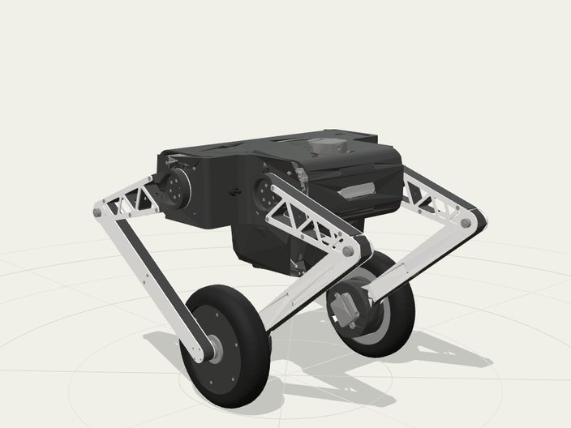
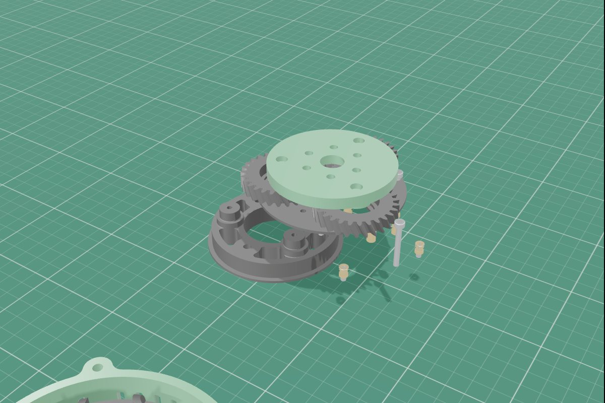
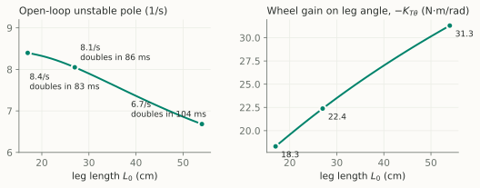
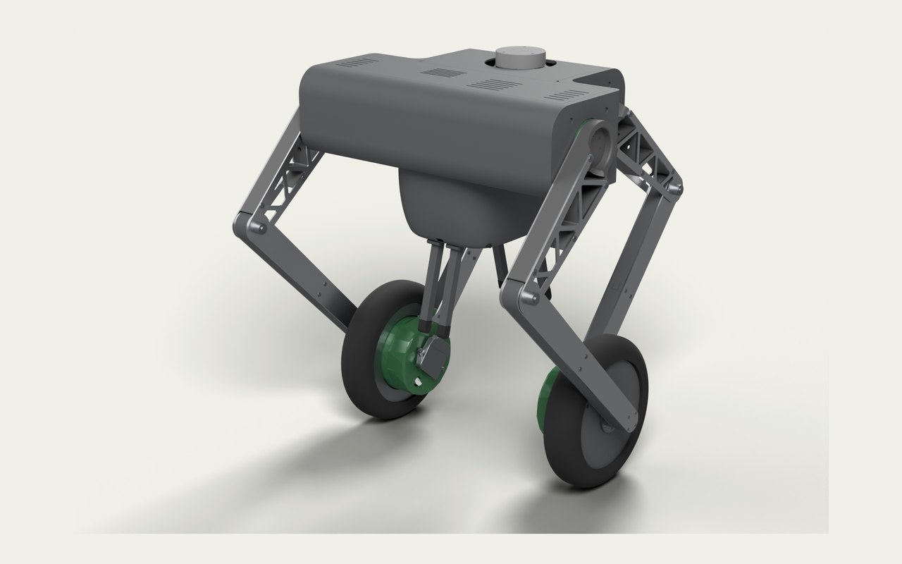

PRIMUS stands for Parallel-linkage Robot with Integrated Mobility and Underactuated Stabilization. It is a wheel-legged biped that I designed in Fusion 360 and built. Each leg is a closed five-bar linkage driven by two hip actuators, with a wheel at the foot. The robot balances on its two wheels like an inverted pendulum and uses its legs to change ride height, keep the body level and absorb rough ground.

<div class="primus-cards">
<a href="#primus-3d"><strong>Explore the 3D model</strong><span>Every part of the CAD, posed with the real leg kinematics.</span></a>
<a href="/portfolio/primus-assembly/"><strong>Build guide</strong><span>Thirty-four animated steps, from inside the actuators to the finished robot.</span></a>
<a href="/portfolio/primus-control/"><strong>Control and learning</strong><span>The controller's equations and the reinforcement-learning experiments.</span></a>
</div>

The model below is the CAD assembly as the simulator sees it, link by link. The leg slider drives the real five-bar geometry, so the knees and wheels move the way they do on the robot.

<figure class="project-figure primus-viewer" id="primus-3d" data-models="/files/primus/model/">
  <div class="pv-stage"></div>
  <figcaption>Every component of the Fusion 360 assembly, with its CAD appearance, posed link by link with the same kinematics as the simulator. Hidden internals are simplified to keep the download near 7.5 MB. The leg length runs over the operating range, 0.18–0.52 m from hip to axle.</figcaption>
</figure>
<script type="importmap">{"imports":{"three":"/assets/vendor/three/three.module.min.js","three/addons/":"/assets/vendor/three/addons/"}}</script>
<script type="module" src="/assets/primus-viewer.js?v=hq1"></script>

## The robot at a glance

<table class="primus-specs">
<tbody>
<tr><td>Mass</td><td>15.7 kg in the CAD, with corrected material densities</td></tr>
<tr><td>Legs</td><td>2 closed five-bar linkages, each with 2 actuated hips and 2 passive knees</td></tr>
<tr><td>Actuators</td><td>6 quasi-direct-drive actuators with a 9:1 printed gearbox (4 hips, 2 wheels), mjbots moteus-r4 controllers, 24 V</td></tr>
<tr><td>Wheels</td><td>Ø 215 mm</td></tr>
<tr><td>Leg length</td><td>0.18–0.52 m from hip to axle, 0.27 m nominal</td></tr>
<tr><td>Sensing</td><td>WitMotion IMU, joint encoders, motor current, RealSense D435i depth camera, RPLIDAR A1</td></tr>
<tr><td>Compute and power</td><td>Jetson Orin Nano, Raspberry Pi 5, Milwaukee M18 battery</td></tr>
<tr><td>Extras</td><td>Retractable landing gear on two servos</td></tr>
</tbody>
</table>

The five-bar gives each leg two degrees of freedom in its plane. Turning the two hip arms in opposite directions shortens or extends the leg. Turning them together swings the wheel forward or back. Putting both motors on the chassis keeps the moving legs light, and the knees can stay passive. The price is a closed kinematic chain, which takes extra work in both the simulator and the controller.

## From Fusion 360 to a simulator

I wanted the simulation to come straight from the CAD. Two Fusion 360 scripts classify every body by the link it belongs to and export it with its mass properties. A Python pipeline then turns those exports into simplified visual meshes, convex collision hulls (computed with CoACD) and an inertia for each link. From there the MuJoCo model (MJCF) and a URDF for Isaac Sim are generated. Imported vendor models often come in with the wrong material, so the battery, aluminium profiles, Jetson, lidar and Raspberry Pi get their real masses before the inertias are computed.

The closed legs are kept as closed loops. In MuJoCo each five-bar is closed with an equality constraint at the wheel axle, and the measured gap stays below 0.1 mm. The viewer above uses the same Fusion 360 assembly, exported body by body at full resolution.

## Balancing with a model-based controller

The base controller runs at 1 kHz and is the same code for the simulator and the robot. An LQR balances the robot from a planar model of half of it: a wheel, a leg of variable length and half of the body. The leg's centre of mass sits near the wheel because the wheel actuator rides on the shin, so a textbook model with the mass at mid-leg gave wrong gains. Instead, the model is linearised at each leg length with the real five-bar pose, mass and inertia, and the gains are stored as cubic fits over 0.17–0.54 m.

Virtual model control turns the balance output into hip torques. The controller decides on a force along the leg and a torque about the hip, then maps them to the two hip motors through the Jacobian of the closed linkage, so the passive knees follow. Around this sit loops for leg length, roll, yaw and keeping the two legs in step. When turning, a feed-forward term shifts load to the outer leg in proportion to the lateral acceleration, and the turn rate is limited so the inner wheel keeps at least 20% of the weight.

By default the controller only sees what the real robot can measure: the IMU attitude and gyro, wheel-encoder odometry corrected for the rotation of the shin, and wheel contact estimated from the hip torques. In simulation it held a steady pitch within 0.2° on flat ground, recovered from an 80 N push in about a second, climbed a 13° ramp with one wheel while keeping the body level, and drove through zig-zags at up to 2 m/s with legs as tall as 0.52 m without falling.

The equations behind all of this, from the half-robot model and its linearisation to the LQR, the gain schedule and virtual model control, are worked through with numbers on a [separate page on control and learning](/portfolio/primus-control/).

## Learning on top of the controller

My first reinforcement-learning attempt gave PPO raw torques for all six motors in Isaac Sim. The policy never learned to balance. It lowered the landing gear and sat on it, because the reward still paid well for a tilted robot. With a working LQR available, that approach wasted samples and invited the policy to exploit the reward.

The approach that worked keeps the model-based controller in charge and lets a policy add corrections: changes in each leg's length and angle, and extra wheel torque. The last layer of the policy starts at zero, so training begins exactly from the controller's behaviour. Training runs in MuJoCo Warp with 4096 robots on one GPU, with the physics and the controller at 1 kHz inside a single CUDA graph. The policy only observes the robot's own sensors with noise, while the critic also gets the true velocity, a height map and the randomised physical parameters.

On held-out terrain with pushes, 2160 simulated robots over 60 s each, the first residual policy fell about four times less often than the controller alone and halved the speed-tracking error:

| | Controller only | Controller + learned residual |
|---|---:|---:|
| Falls per robot-minute | 0.265 | 0.069 |
| Speed error (m/s) | 0.207 | 0.094 |

<figure class="project-figure">
  <video controls playsinline preload="none" poster="/images/primus/demo-poster.jpg" aria-label="Simulated PRIMUS driving across the test arena"><source src="/files/primus/demo-arena.mp4" type="video/mp4"><a href="/files/primus/demo-arena.mp4">Watch the arena video</a></video>
  <figcaption>PRIMUS in the MuJoCo test arena: floor patches, a 13° ramp, bumps and rough terrain. The controller runs on sensor-realistic state, the signals the real robot can measure.</figcaption>
</figure>

## Perception and autonomous skills

Steps taller than the wheel radius, about 10 cm, cannot be rolled over. Without hip abduction the robot cannot lift one leg at a time either, so it has to hop with both wheels. A jump primitive in the controller packs that push into a single action, and a skill policy decides when and how to use it.

The perception stack turns the D435i depth image into a robot-centred elevation map and detects stairs, curbs, drops, gaps and low overhangs, while the lidar watches for obstacles. An edge guard stops the robot before anything it should not drive into. When a feature is within what the policy can cross, the pilot panel offers it, for example "stairs down 5×13 cm at 1.1 m", and one button hands control to the skill policy until the robot is across.

The current policy is a single network that always runs on top of the controller. It assists normal driving and switches to full authority for a skill. In simulation it fell 0.06 times per minute on flat ground with pushes, against 0.29 for the controller alone. It crossed gaps up to 45 cm in 94–100% of trials and passed under overhangs in 88–100%. A student policy that uses only the simulated camera map was distilled from it and stays within a few points of its teacher when riding, on stairs, under overhangs and across gaps up to 45 cm. It still trails the teacher on the tallest hurdles and the widest gaps.

Getting there took thirteen teacher versions, and several lessons came from mistakes in evaluation rather than in learning. An apparent jump from 22% to 56% success turned out to come from about 20 robots per test cell, so every result now uses at least 150. A version that looked strong relied on motors and joints the robot does not have, and modelling the real ones cost 50 percentage points on the hardest stairs. Training on 24 cm hurdles and 0.8 m gaps mostly taught the policy to refuse, because those are close to what the hardware can physically do. The [control and learning page](/portfolio/primus-control/) goes through each experiment, the reward design and the PPO details.

## Operating PRIMUS

The same pilot interface drives the simulator today and is meant for the robot. The pilot never moves the landing gear directly. They ask the robot to stand up or to land, and the controller moves through four modes:

1. **Parked.** Legs at 0.18 m and the landing gear down, resting on the ground. The robot does not balance.
2. **Standing up.** Balancing starts, the legs rise above 0.25 m, and once the robot is still for half a second the gear retracts.
3. **Operating.** Any leg length from 0.18 to 0.52 m, with the speed and turn rate from the sticks.
4. **Landing.** The robot stops, lowers the gear, descends quickly to 0.25 m and then slowly onto the gear, ending parked again.

| Action | Xbox controller | Meta Quest 3 | Keyboard |
|---|---|---|---|
| Speed, up to 1.5 m/s | Left stick Y | Left stick | W / S |
| Turn | Right stick X | Right stick | A / D |
| Leg height (latches) | Triggers or D-pad | Triggers | E / Q |
| Hard brake, or cancel a skill | B | B | Space |
| Start the offered skill | A (browser panel) | A | Enter |
| Edge guard on or off | Back (browser panel) | Hold B for 1 s | G |
| Land or stand up | X | X | P |
| Restart | Start | Y | R |
| Responsiveness: smooth, normal, sport | LB / RB | Left / right stick click | 1 / 2 / 3 |

The three responsiveness levels set how quickly the robot reaches the commanded speed, 0 to 1.5 m/s in about 2.7, 1.2 or 0.7 s at the nominal leg length. The edge guard is on by default. It caps the speed so the robot stops about 0.35 m before drops deeper than 6 cm, steps higher than 5 cm, gaps, walls, low overhangs or ground the camera has not seen yet. Piloting from a Quest 3 streams the robot's first-person camera to the headset over Wi-Fi, with a panel for the mode, leg height, torques and wheel contact.

To run the simulation from the [repository](https://github.com/roandr694/PRIMUS):

```bash
cd sim
python3 -m pip install -r requirements.txt   # mujoco, numpy, scipy, pygame, aiohttp, pillow
python3 scripts/check_model.py               # load the model, stand up, balance for 5 s, report the loop gap
python3 scripts/run_xbox_viewer.py           # drive with a gamepad (on macOS, use mjpython)
python3 scripts/run_quest_viewer.py          # pilot from a Meta Quest 3 or a desktop browser
```

The robot starts parked on its landing gear and stands up by itself.

## Building one

The [build guide](/portfolio/primus-assembly/) takes PRIMUS from loose parts to a standing robot in thirty-four steps, starting with the inside of the actuators. Each step plays as a 3D animation generated from the Fusion 360 assembly, in an order the parts allow, and the page ends with the full bill of materials. It is also available [as a PDF](/files/primus/primus-assembly-guide.pdf). The CAD-derived meshes, the simulator and the controller are in the [PRIMUS repository](https://github.com/roandr694/PRIMUS).

## Status

The robot is built, and everything above has been validated in simulation. The next step is the hardware side. The actuators still need to be characterised for peak torque, speed, rotor inertia and backlash, since the simulator uses estimates for all four. After that come the drivers and state estimation on the real robot, then the controller and, at reduced authority at first, the learned policies on the Jetson. Until then, every number on this page is a simulation result.
