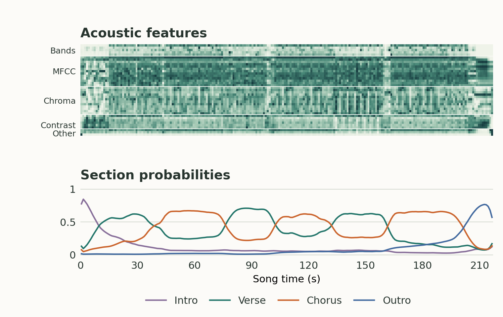
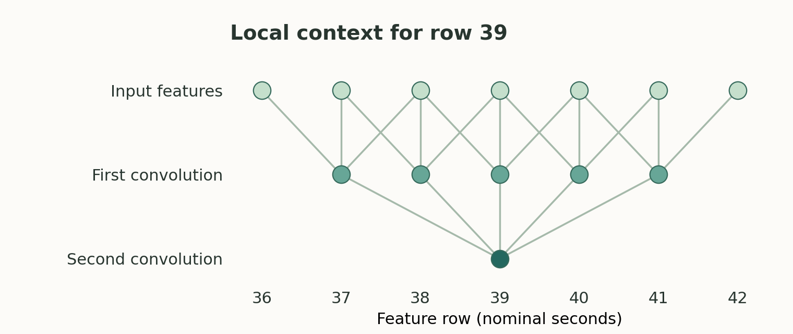
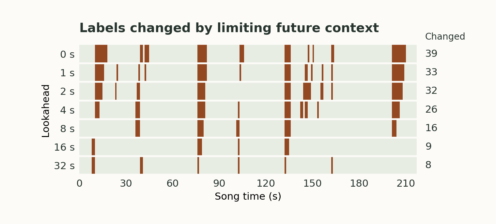

## Where should the next track come in?

For our EE 460 final project, we built a browser-based DJ assistant. We wanted it to handle a choice a DJ makes by ear. Suppose the current song has another verse after a chorus, but the chorus already feels like a good place to leave. Which song in the library has an entrance that would work there? Matching the two tempos still leaves both cue points to choose.

We split that problem into two parts. A sequence model listens to each recording and makes a map of its sections. A planner reads those maps, recommends the next track and picks an effect. The DJ can inspect the recommendation while the first track is still playing.

## Getting from audio to a section map

Our original plan was to hand-label 75 songs. We switched to existing annotations from SALAMI and Harmonix and assembled roughly 794 tracks. SALAMI gave us a mix of genres, including jazz, classical and rock. Harmonix contributed about 500 pop songs, where a verse returning after a chorus is a familiar pattern. To train one model on both collections, we mapped their annotations to intro, verse, chorus or outro. A hook counted as chorus. A bridge or pre-chorus counted as verse. That last choice means the planner can lose the distinction between a quiet verse and the build immediately before a hook. [SALAMI annotations](https://github.com/DDMAL/salami-data-public) · [Harmonix Set](https://github.com/urinieto/harmonixset)

Each second of a recording becomes a row of 39 measurements. Five energy bands describe how much sound sits in different frequency ranges. Thirteen mel-frequency cepstral coefficients summarize the spectral shape, a cue to the timbre of voices and instruments. Twelve chroma values describe which notes are present across octaves. The remaining nine measurements capture spectral contrast, rolloff, zero crossings and flatness. Together they let the model pick up changes such as a familiar chord progression returning with brighter percussion. [Feature extractor](https://github.com/stevecho0101/Structure_Aware_DJ_Transition/blob/d6df1fe5c57185a5bed64b5f9494c165c2d38054/spectrogram.py)

<figure class="project-figure">
  
  <figcaption>One pass of the released model on “Baby” by Justin Bieber feat. Ludacris. Each column is about one second. The curves show the probability assigned to each section. <a href="/files/dj-transition/checkpoint-trace.csv">Per-second outputs (CSV)</a></figcaption>
</figure>

### Why we added a bidirectional LSTM

Our first design used a convolutional network. Two filters slide along the time axis, first across three rows and then across five outputs from the first layer. One output from the second layer therefore combines seven seconds of input. That is enough to capture a drum fill or a change in texture. In our early experiments, the CNN plateaued on the harder question of whether a passage was a verse or a chorus. Both can have the same instruments, chords and volume.

<figure class="project-figure">
  
  <figcaption>Tracing one output back to its inputs. Each dot represents a vector of channels at one time step. The connections show the temporal receptive field before the recurrent layers.</figcaption>
</figure>

We had listed a bidirectional LSTM as future work and ended up using it in the final model. An LSTM carries information from one time step to the next. Running it in both directions lets the classifier interpret a passage in light of what leads into it and what follows it. We can afford that lookahead because the library can be analyzed before playback. The final layer assigns four scores at each second. A nine-second median filter smooths brief label changes, and the final continuous segment is assigned to outro.

### Training and the reported result

We split the data by song, reserving 20% of files for validation, then cut each recording into 128-second windows with 50% overlap. Splitting first keeps two windows containing the same chorus on the same side of the split. We trained in batches of 16 using Adam with an initial learning rate of 0.001 and early stopping. Inverse-frequency weighting gave rare sections such as intros and outros more influence on the loss. [Training and inference code](https://github.com/stevecho0101/Structure_Aware_DJ_Transition/blob/d6df1fe5c57185a5bed64b5f9494c165c2d38054/train_cnn_lstm.py)

We reported **about 55% per-second accuracy** across the four section labels. A uniform random guess would average 25%. The unit matters here. A chorus entrance placed five seconds early can still earn credit for most of the chorus, even though a DJ acting on that cue could cut off the previous vocal line. In the booth, the DJ can inspect that timestamp and decide whether the cut works by ear.

## How the planner chooses a transition

In our “Strobe” → “Levels” example, the plan leaves “Strobe” late in a chorus at **3:22** and brings in “Levels” at **0:08**. Those are timestamps on two different recordings. The chosen low-pass sweep gradually removes high frequencies from the outgoing track while the incoming one opens up.

To make that decision, Claude receives the section start times for the current track and the candidates, the recent play history, and any earlier ratings or comments. It returns structured data with the next filename, the exit and entry cues, the effect, and its reasoning. Keeping this interface small also made it practical to cache the section maps and try a different recommendation without rerunning the classifier. [Transition planner](https://github.com/stevecho0101/Structure_Aware_DJ_Transition/blob/d6df1fe5c57185a5bed64b5f9494c165c2d38054/agent.py)

## Mixing in the browser

We initially planned to export a mixed MP3. Moving playback into the browser let us try a recommendation *during* a set. The yellow marker in the booth shows the proposed exit. The DJ can see which section of the next song will play, override the effect, then rate how it sounded. The next planning request includes that feedback.

<figure class="project-figure">
  
  <figcaption>The browser booth during a set. The yellow marker shows when to leave “SOS.” Below it, the DJ can inspect the proposed entrance for “That’s What I Like,” change the effect, and rate the transition.</figcaption>
</figure>

We also revised the effects. Echo and phaser were in the proposal. The final booth offers a volume crossfade, a low-pass sweep to change brightness, an EQ sweep to trade the bass between tracks, and a beatmatch mode that adjusts playback rate using tempo information. The two clips below use the project’s Python renderer on the same original synthesized loops, with the same hand-set cues. At six seconds, the incoming chords enter. Listen to the outgoing arpeggio in each version. [Effects renderer](https://github.com/stevecho0101/Structure_Aware_DJ_Transition/blob/d6df1fe5c57185a5bed64b5f9494c165c2d38054/add_effect.py)

<figure class="project-figure">
  <h3 id="dj-crossfade">Crossfade</h3>
  <audio controls preload="none" aria-labelledby="dj-crossfade" style="width:100%;max-width:34rem" src="/files/dj-transition/crossfade.mp3"><a href="/files/dj-transition/crossfade.mp3">Play the crossfade MP3</a></audio>
  <figcaption>The outgoing arpeggio drops in level through the two-second overlap.</figcaption>
</figure>

<figure class="project-figure">
  <h3 id="dj-sweep">Low-pass sweep</h3>
  <audio controls preload="none" aria-labelledby="dj-sweep" style="width:100%;max-width:34rem" src="/files/dj-transition/low-pass-sweep.mp3"><a href="/files/dj-transition/low-pass-sweep.mp3">Play the low-pass sweep MP3</a></audio>
  <figcaption>The same notes lose their high frequencies as the incoming filter opens. The cue times and source audio are identical to the crossfade.</figcaption>
</figure>

## What the cue leaves out

A follow-up analysis of the released checkpoint makes the timing problem visible. On the bundled recording of “Baby,” verse and chorus are almost tied at 0:38. Chorus takes the lead one row later. The planner sees “chorus starts at 0:39,” with no indication of how narrow the margin was.

The plot below asks how much that decision sequence depends on hearing what comes next. With full-song feature normalization held fixed, hiding all later rows changed 39 of 217 predictions. Allowing eight future rows reduced that count to 16. This is a measure of sensitivity to context on one recording. [Reproduce the experiment](https://github.com/roandr694/roandr694.github.io/blob/master/scripts/research/dj_context_probe.py)

<figure class="project-figure">
  
  <figcaption>Each rust-colored mark is a time step whose highest-scoring class changed. The count on the right sums those marks for each lookahead setting. Pale cells retained the full-song label.</figcaption>
</figure>

The next step we identified was to give the system beat position, along with better vocal and tempo features and a larger song pool. At 120 BPM, two beats fit inside one label. If the classifier can narrow a transition to a short interval, a beat tracker could pick a downbeat inside it. I’d want to hear that cue next to the current one in a blind listening comparison.
