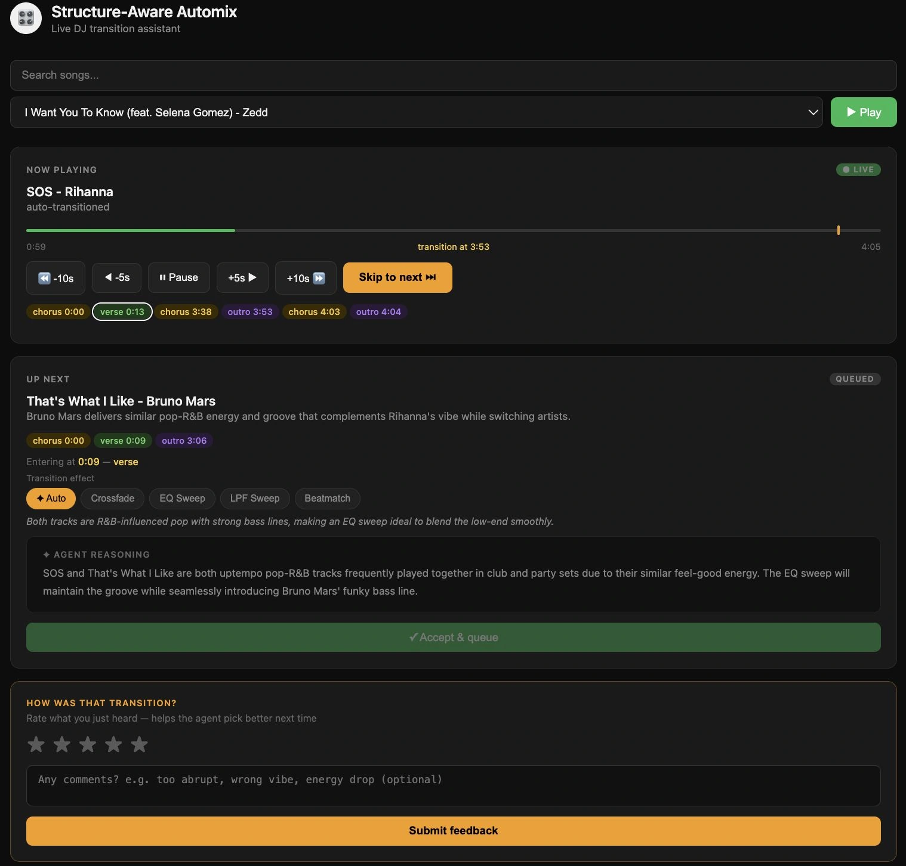

## Learning a section label for every second

The prediction task is temporal segmentation. Given a recording of length *T*, the model produces a sequence of *T* labels drawn from intro, verse, chorus, and outro. A chorus can return several times, so predicting one genre or one label for the whole track would discard the structure a DJ needs.

The training scripts draw supervision from SALAMI and Harmonix. Human annotators marked section boundaries and named their musical functions. The scripts turn those intervals into one target per second and reconcile the vocabularies across the datasets. For example, a hook maps to chorus, while a bridge or pre-chorus maps to verse. That choice has an audible consequence. Even a perfectly classified pre-chorus comes back to the planner as “verse,” although a DJ might want to preserve the build into the hook. [SALAMI annotations](https://github.com/DDMAL/salami-data-public) · [Harmonix Set](https://github.com/urinieto/harmonixset)

### What the network can hear

Each recording is resampled to 22.05 kHz and converted to mono. The feature extractor averages short-time measurements into roughly one-second rows. Five energy bands describe where the sound is loud. Thirteen mel-frequency cepstral coefficients (MFCCs) summarize the shape of the spectrum, which helps distinguish timbres. Twelve chroma values track pitch classes across octaves, so a returning chord progression can remain recognizable after the instrumentation changes. Six spectral-contrast values and three additional descriptors capture differences in texture, brightness, and noisiness.

For the bundled recording of “Baby,” that gives the model a **217 × 39** input matrix. Each feature is first scaled to its range within the song, then standardized using the statistics saved at training time. A dark cell in the heatmap below means that feature is high *for this recording*. Absolute loudness across songs has already been lost at this stage. [Feature extractor](https://github.com/stevecho0101/Structure_Aware_DJ_Transition/blob/d6df1fe5c57185a5bed64b5f9494c165c2d38054/spectrogram.py)

<figure class="project-figure">
  
  <figcaption>One pass of the released model on “Baby” by Justin Bieber feat. Ludacris. Each column is about one second. The curves show the probability assigned to each section. <a href="/files/dj-transition/checkpoint-trace.csv">Per-second outputs (CSV)</a></figcaption>
</figure>

At 0:38 in this recording, the classifier narrowly favors verse over chorus, 0.443 to 0.437. One row later, chorus takes the lead, 0.452 to 0.432. The planner receives a crisp instruction that the chorus starts at 0:39. It never sees how close that decision was. That boundary is a useful place to start understanding the system.

### From a local change to a musical section

The first convolution slides a three-row filter along time and produces 32 channels. The second combines five neighboring outputs into 64 channels. Because the windows overlap, the second convolution at row 39 can draw on seven input rows, 36 through 42. There is one output per input row, so a transition stays attached to its position in the song.

<figure class="project-figure">
  
  <figcaption>Tracing one output back to its inputs. Each dot represents a vector of channels at one time step. The connections show the temporal receptive field before the recurrent layers.</figcaption>
</figure>

A short burst of bright instrumentation could be a fill or the start of a chorus. To resolve that ambiguity, two stacked bidirectional LSTM layers read the convolutional features in both time directions. At each row, the network joins a 128-value state from each direction. A linear layer maps those 256 values to four scores. Softmax turns the scores into the probabilities in the inference trace. The complete network has **609,220 trainable parameters**.

### What was optimized

The training code reserves 20% of song files for validation **before** cutting tracks into 128-row windows with a stride of 64. Otherwise, neighboring windows could put the same minute of audio on both sides of the split. The loss is weighted cross-entropy. It penalizes a low probability for the annotated class, with a larger weight for classes occupying fewer training rows. Padded targets at the end of a window are ignored.

The code selects the checkpoint by overall per-row validation accuracy. A long correctly identified verse helps that metric even if its last few seconds are misplaced. For a DJ, those seconds may be the whole point. I’d evaluate the boundaries separately by matching predicted and annotated changes within a timing tolerance, and report results by section type as well as by song. The released weights make the inference figures here reproducible. The repository does not include a validation report or a manifest identifying the songs in the original split. [Training and inference code](https://github.com/stevecho0101/Structure_Aware_DJ_Transition/blob/d6df1fe5c57185a5bed64b5f9494c165c2d38054/train_cnn_lstm.py)

## What happens at an actual boundary?

On the bundled recording, the model produces eight continuous sections. The project applies a nine-row median filter to the labels and assigns the final run to outro. Neither step changes a label on this example. The alternating verse and chorus pattern in the inference trace comes from the checkpoint itself.

Harmonix contains an annotation for the same song. Reading a few corresponding boundaries side by side shows why the distinction between identifying a section and locating its entrance matters.

| Section begins | Checkpoint on bundled MP3 | Harmonix annotation |
| --- | ---: | ---: |
| First chorus | 0:39 | 0:44.4 |
| Second chorus | 1:43 | 1:43.4 |
| Third chorus | 2:42 | 2:42.5 |
| Outro | 3:21 | 3:12.1 |

The middle two entrances fall close together on their respective clocks. The outro differs by almost nine seconds. The MP3 runs 216.7 seconds and the Harmonix metadata lists a 214.2-second release. These are the original timestamps with no alignment correction. The recording versions and unknown training membership limit what this one comparison can establish. [Human section annotations](https://github.com/urinieto/harmonixset/blob/64abeb509429e73d74559fb98e621dac866efea1/dataset/segments/0573_babyludacris.txt) · [Recording metadata](https://github.com/urinieto/harmonixset/blob/64abeb509429e73d74559fb98e621dac866efea1/dataset/metadata.csv)

## How much does the model use future audio?

A DJ can analyze a library before a set. A robot estimating the phase of a motion from live sensors has to act before its next observation arrives. How much would this checkpoint’s interpretation of the present change if the end of the sequence were hidden?

The experiment runs the same model 217 times, once for each row, on a prefix ending at that row. It repeats the sweep allowing 1, 2, 4, 8, 16, or 32 future rows. Each prediction was compared with the full-song prediction **at the same row**, before smoothing. The features and their full-song normalization were held fixed to isolate the effect of truncating the network input.

<figure class="project-figure">
  
  <figcaption>Each rust-colored mark is a time step whose highest-scoring class changed. The count on the right sums those marks for each lookahead setting. Pale cells retained the full-song label.</figcaption>
</figure>

With zero future rows, **39 of 217 labels changed (18.0%)**. Eight rows of lookahead brought that to **16 (7.4%)**. Many disagreements cluster near a transition, exactly where the planner wants a cue. This measures sensitivity to future context on one track. A live estimator would also need causal feature extraction and normalization. A comparison against human labels on held-out recordings would answer the separate question of which predictions are more accurate. [Reproduce the experiment and figures](https://github.com/roandr694/roandr694.github.io/blob/master/scripts/research/dj_context_probe.py)

## From predicted sections to an audible transition

The app caches each song’s labels and compresses consecutive repeats into a list of section start times. Claude receives those lists, filenames, playback history, and listener feedback. It proposes a next song, exit time, entry time, and one of four effects. The audio engine can crossfade, trade the bass with an EQ sweep, open and close a low-pass filter, or adjust playback rate for a beatmatch. A listener can override the effect and rate the result. That feedback goes into the next planning prompt. The section model’s weights stay fixed. [Planner](https://github.com/stevecho0101/Structure_Aware_DJ_Transition/blob/d6df1fe5c57185a5bed64b5f9494c165c2d38054/agent.py) · [Effects renderer](https://github.com/stevecho0101/Structure_Aware_DJ_Transition/blob/d6df1fe5c57185a5bed64b5f9494c165c2d38054/add_effect.py)

<figure class="project-figure">
  
  <figcaption>The live booth from the team’s EE 460 presentation. The yellow marker shows when to leave “SOS.” Below it, the DJ can inspect the proposed entrance for “That’s What I Like,” change the effect, and rate the transition.</figcaption>
</figure>

The two clips below isolate the rendering step. They use original synthesized loops at 120 BPM, with identical manually selected cues. Track B enters six seconds into each clip. Listen to the bright arpeggio as the incoming chords take over.

<figure class="project-figure">
  <h3 id="dj-crossfade">Crossfade</h3>
  <audio controls preload="none" aria-labelledby="dj-crossfade" style="width:100%;max-width:34rem" src="/files/dj-transition/crossfade.mp3"><a href="/files/dj-transition/crossfade.mp3">Play the crossfade MP3</a></audio>
  <figcaption>The outgoing arpeggio drops in level through the two-second overlap.</figcaption>
</figure>

<figure class="project-figure">
  <h3 id="dj-sweep">Low-pass sweep</h3>
  <audio controls preload="none" aria-labelledby="dj-sweep" style="width:100%;max-width:34rem" src="/files/dj-transition/low-pass-sweep.mp3"><a href="/files/dj-transition/low-pass-sweep.mp3">Play the low-pass sweep MP3</a></audio>
  <figcaption>The same notes lose their high frequencies as the incoming filter opens. The cue times and source audio are identical to the crossfade.</figcaption>
</figure>

The first chorus is where I’d change the interface between perception and planning. At 0:39 the planner gets a single timestamp, even though the model still gives verse almost as much weight as chorus. I’d pass a short interval around that crossover to a beat tracker, choose a downbeat inside it, and compare the resulting mix with the current cue in a blind listening test. That would test whether a better boundary estimate translates into a better transition.
