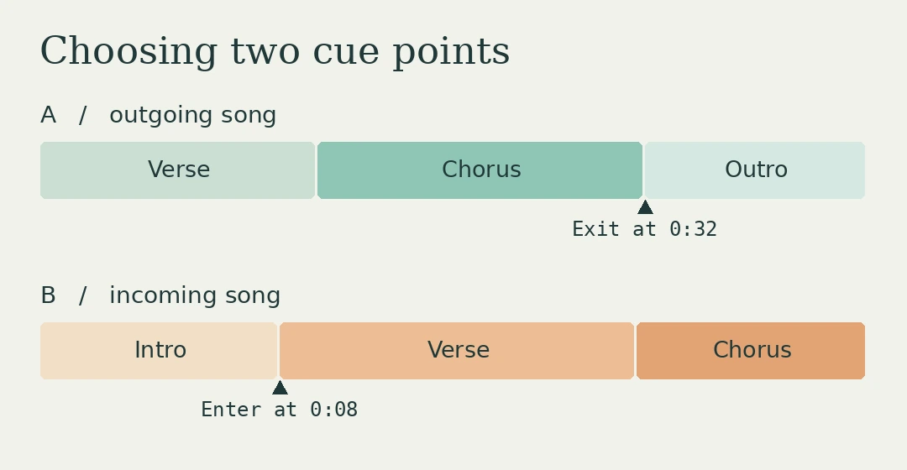

Two tracks can have the same tempo and still make an awkward mix. If the second song comes in halfway through a chorus, it can sound like someone changed the station. This project gives a DJ assistant a rough map of each song so it can choose where to leave one track, where to enter the next, and how to mix those few seconds.

## Hear the handoff

These are two renders of the same 14 seconds. The first track has a quick, bright arpeggio. The second answers it with chords on the offbeat. Listen from about five seconds in and follow the high notes as the chords arrive.

<figure class="project-figure">
  <h3 id="dj-crossfade">Crossfade</h3>
  <audio controls preload="none" aria-labelledby="dj-crossfade" style="width:100%;max-width:34rem" src="/files/dj-transition/crossfade.mp3"><a href="/files/dj-transition/crossfade.mp3">Play the crossfade MP3</a></audio>
  <figcaption>The arpeggio gets quieter while the chords come up underneath it.</figcaption>
</figure>

<figure class="project-figure">
  <h3 id="dj-sweep">Low-pass sweep</h3>
  <audio controls preload="none" aria-labelledby="dj-sweep" style="width:100%;max-width:34rem" src="/files/dj-transition/low-pass-sweep.mp3"><a href="/files/dj-transition/low-pass-sweep.mp3">Play the low-pass sweep MP3</a></audio>
  <figcaption>The outgoing track also loses its high frequencies. The incoming chords start muffled and brighten as the filter opens.</figcaption>
</figure>

Both examples use original synthesized material at 120 BPM and the project’s Python effects renderer. The cue points were set by hand and held fixed so you can hear what changing the effect does.

## How does it know where the chorus is?

The classifier starts with 39 measurements for each second of audio. Five describe how energy is distributed from bass to treble. Twelve track the strength of the twelve pitch classes, grouping notes an octave apart together. Other measurements capture the shape of the spectrum and how noisy or tonal it sounds. A chorus might bring back a familiar chord pattern, with brighter cymbals and a fuller bass line. Each measurement captures a different piece of that change.

A convolutional network looks for short patterns across neighboring seconds. A bidirectional LSTM, a sequence model that reads the song forward and backward, puts those patterns in context. A quiet second just before a chorus and a quiet second at the end of a song can look similar in isolation. Having the rest of the recording available helps the classifier tell them apart.

The training pipeline uses section annotations from SALAMI and Harmonix, mapped to four labels: intro, verse, chorus, and outro. It holds out whole songs for validation. At inference, it smooths the second-by-second predictions with a nine-second median filter and assigns the final continuous segment to the outro. That last step is a design choice worth knowing about when a track ends abruptly.

## Turning sections into cue points

Consecutive seconds with the same label collapse into a single entry, such as “chorus starts at 0:24.” The planner gets these short timelines for the current track and the candidates. Claude proposes the next track, an exit time, an entry time, and a transition effect, with a reason for each choice.

<figure class="project-figure">
  
  <figcaption>An example plan. The timestamps refer to each track’s own clock. Section widths are schematic, and the labels illustrate what a planner receives.</figcaption>
</figure>

In the listening example, the outgoing audio ends at 0:32 on track A. The renderer starts track B from its own 0:08 cue two seconds before A ends. The excerpt begins at 0:24 on A, so you hear B enter six seconds into the player. That offset is easy to miss when reading a pair of timestamps.

## What the DJ controls

The Flask app lets the listener choose a starting song, inspect the recommendation, and override the effect. A crossfade changes volume. The EQ sweep trades bass between the tracks, the low-pass sweep changes brightness, and the beatmatch mode adjusts the incoming playback rate when tempo information is available. The browser plays the transition with the Web Audio API.

After a transition, a rating and a short comment go into the next recommendation. The app keeps track of songs already played in the session. The section classifier stays fixed, so a comment like “bring the bass back sooner” reaches the planner while the cached song maps stay the same.

One limit I’d keep in mind when listening is timing resolution. At 120 BPM, two beats fit inside a single one-second label. A section map can point to a promising chorus and still leave the kick drums half a beat apart. Finding a musically sensible section and landing on its downbeat are two separate jobs.

[Project repository and setup guide](https://github.com/stevecho0101/Structure_Aware_DJ_Transition) · [Section classifier](https://github.com/stevecho0101/Structure_Aware_DJ_Transition/blob/d6df1fe5c57185a5bed64b5f9494c165c2d38054/train_cnn_lstm.py) · [Transition effects](https://github.com/stevecho0101/Structure_Aware_DJ_Transition/blob/d6df1fe5c57185a5bed64b5f9494c165c2d38054/add_effect.py)
